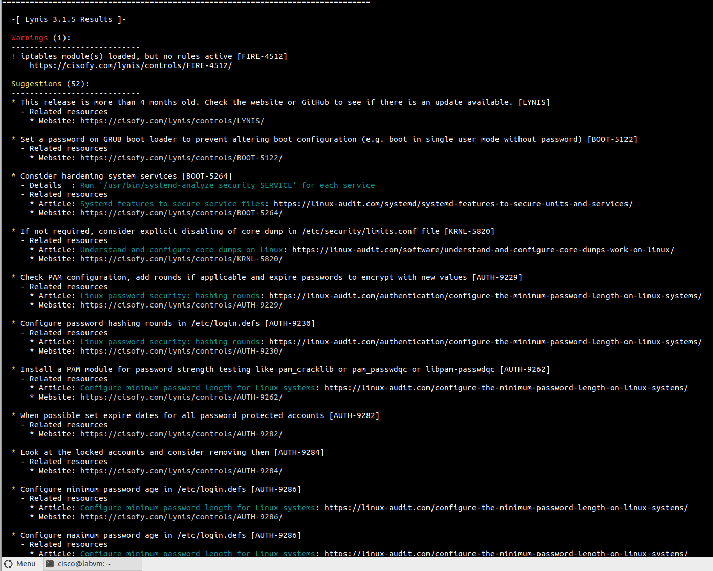
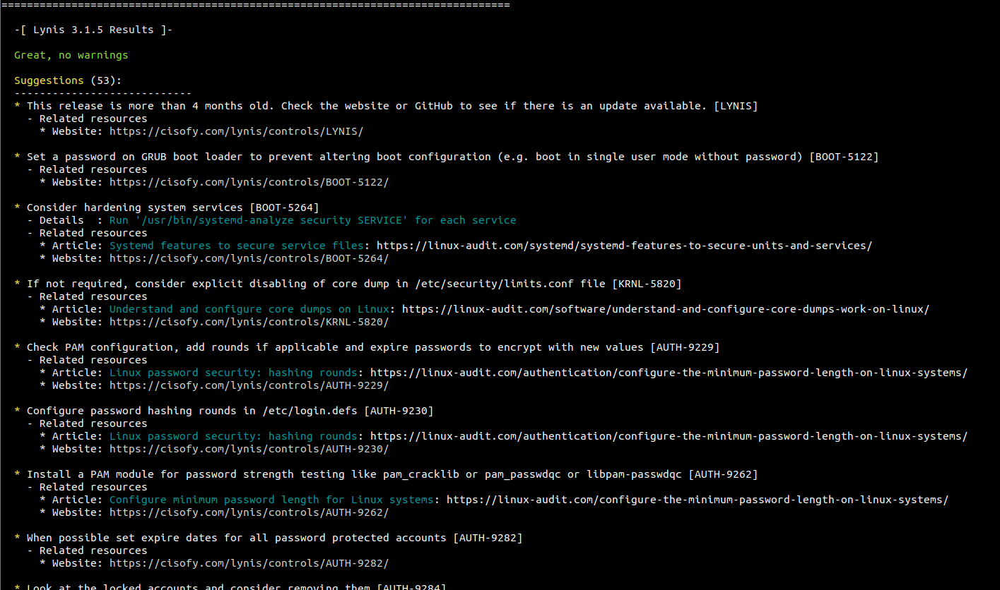
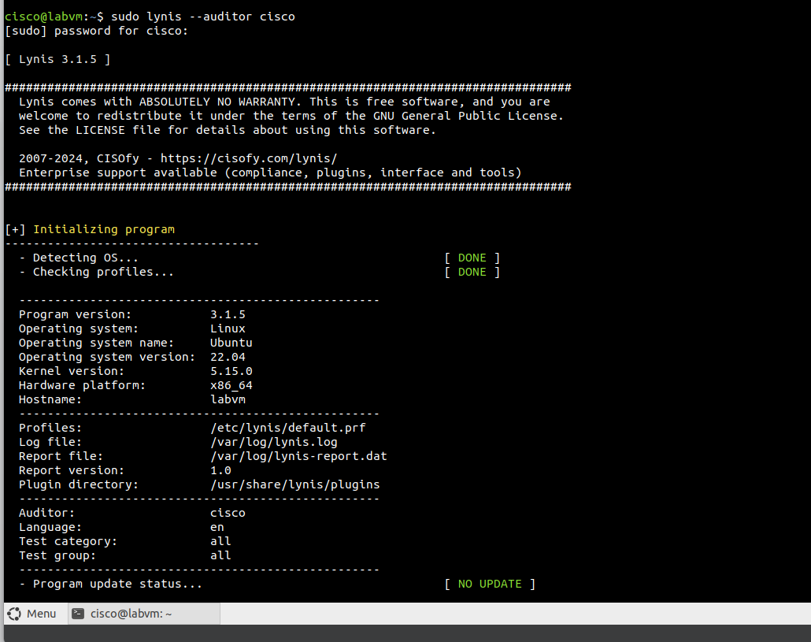
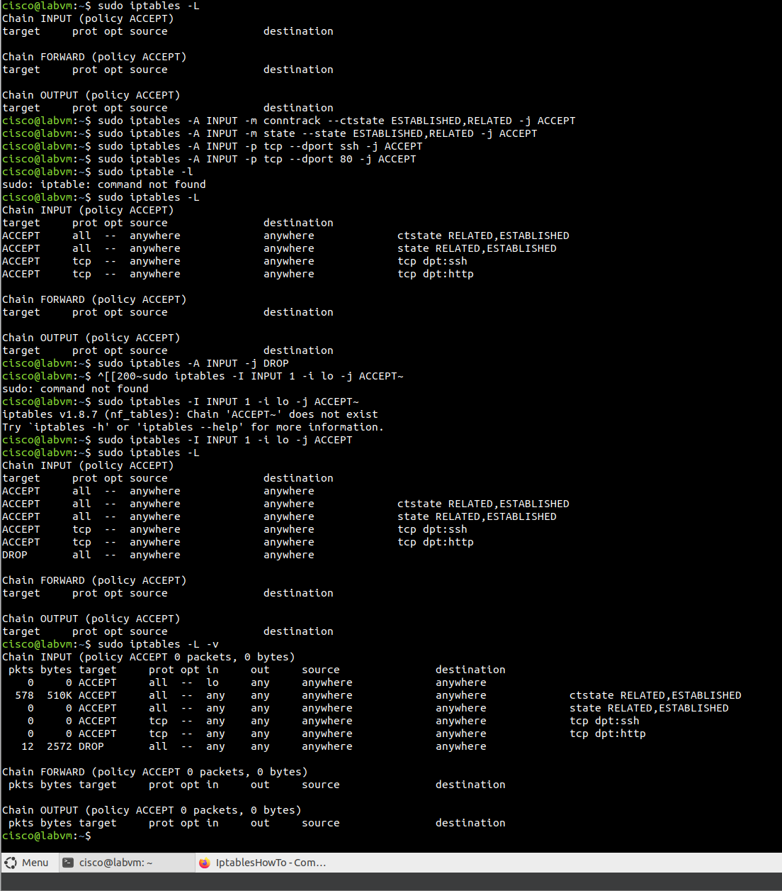
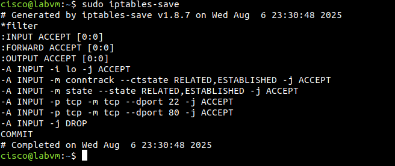
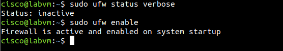

# Lab 02 — Linux Hardening Audit with Lynis

[Portfolio](../../README.md) / [Linux & Windows Security](../README.md)

[Overview](#overview) · [Objectives](#objectives) · [Environment & Tools](#environment--tools) · [What I Did](#what-i-did) · [Evidence & Results](#evidence--results) · [Lessons Learned](#lessons-learned) · [Practical Value](#practical-value)

## Overview

I audited an Ubuntu VM with Lynis, investigated its warning about loaded firewall modules without active rules, added a basic filtering ruleset, and compared the next audit result. The work demonstrates a focused remediation cycle: identify a finding, understand the configuration, apply a change, and check the result.

## Objectives

- Interpret a Lynis warning and the distinction between warnings and suggestions.
- Configure and inspect basic host-firewall rules.
- Separate an active configuration check from persistence and broader security validation.

## Environment & Tools

- Ubuntu 22.04 lab VM
- Lynis 3.1.5
- `iptables`, `iptables-save`, and UFW

## What I Did

1. Ran the audit with `sudo lynis --auditor cisco`.
2. Reviewed warning **FIRE-4512**: `iptables module(s) loaded, but no rules active`.
3. Added input rules for loopback, established/related traffic, SSH, and HTTP, followed by a rule dropping remaining input traffic.
4. Listed the rules and counters to inspect the active configuration.
5. Ran `iptables-save` to display the ruleset in its export format.
6. Enabled UFW; its output reported that the firewall was active and enabled at startup.
7. Re-ran Lynis and compared the warnings and remaining suggestions.

## Evidence & Results

| Before | After |
|---|---|
|  |  |

The follow-up scan reports **no warnings**, resolving the specific audit finding. Its **53 suggestions** remain separate work to review; a cleared warning is not a complete hardening result.

<b>Open the audit and firewall configuration evidence</b>

`iptables-save` writes the ruleset to standard output. Persistence requires an appropriate saved configuration and restore mechanism. UFW has its own managed configuration; enabling it does not establish that separately added `iptables` rules survive a reboot. The captured sequence checks the active state and UFW startup status, with reboot persistence as a distinct verification step.

## Lessons Learned

- Read the finding and inspect the existing rules before choosing a fix.
- Keep loopback and required established connections in mind when filtering input traffic.
- Plan firewall changes around the services and management access that must remain available.
- Validate active rules, service connectivity, and reboot persistence as separate checks.
- Treat remaining audit suggestions as a prioritization queue rather than evidence that every recommendation must be applied blindly.

## Practical Value

The audit/remediation/recheck workflow supports Linux troubleshooting, host configuration review, and clear documentation of a change's scope.

## MITRE ATT&CK Context

[T1562.004 — Disable or Modify System Firewall](https://attack.mitre.org/techniques/T1562/004/) explains why unexpected firewall changes deserve investigation. This lab covers authorized defensive configuration.

> **Author:** Komiljon Karimov 
> **Mission:** Reliable technology and informed security decisions

[Back to portfolio](../../README.md) · [Domain index](../README.md)
