# Lab: Performing System Hardening

[Portfolio](../../README.md) / [Linux & Windows Security](../README.md)

[Overview](#overview) · [Objectives](#objectives) · [Environment & Tools](#environment--tools) · [What I Did](#what-i-did) · [Lessons Learned](#lessons-learned) · [Practical Value](#practical-value)

## Overview
In this lab, I went hands-on with **system hardening** — securing both Windows and Linux machines in a simulated corporate environment (Structureality Inc.).  
I reduced the attack surface by reviewing drivers, removing unneeded software and services, testing a firewall rule, and changing Linux file permissions. I also deliberately changed and restored a hosts-file entry to understand how local name resolution affects troubleshooting. Each change needed a specific check, rather than an assumption that the entire machine was now secure.

## Objectives
This lab helped me practice real-world CySA+ objectives:  
- **1.1**: Understanding system and network architecture in the context of security.  
- **2.5**: Vulnerability response, handling, and management.  

## Environment & Tools
I worked across several virtual machines:  
- **KALI Linux** (for hosts file manipulation and permissions)  
- **DC10** (Windows Server 2019, domain controller + secure web server)  
- **MS10** (Windows Server 2016)  
- **PC10** (Windows Server 2019 client machine)  

And used:  
- Linux terminal (`wget`, `nano`, `chmod`)  
- Windows CMD and PowerShell  
- Device Manager & Server Manager  
- Windows Defender Firewall with Advanced Security  

---

## What I Did

### 1. Managing Device Drivers on Windows
Hardening starts even with something as boring as drivers. Old or insecure drivers can create vulnerabilities, so I checked the **MS10 server** for outdated device drivers.  

- Opened **Device Manager** and scanned for hardware changes.  
- Ran the driver-update check for the virtual DVD-ROM device.
- Windows reported that the best driver was already installed, so I made no driver change.

 *Screenshot proof:*  
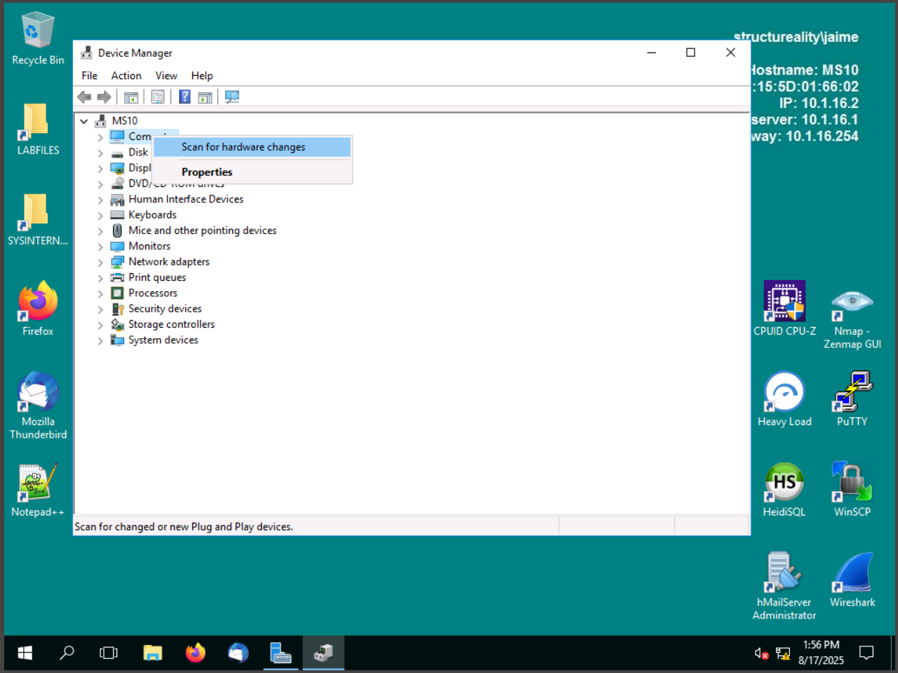  
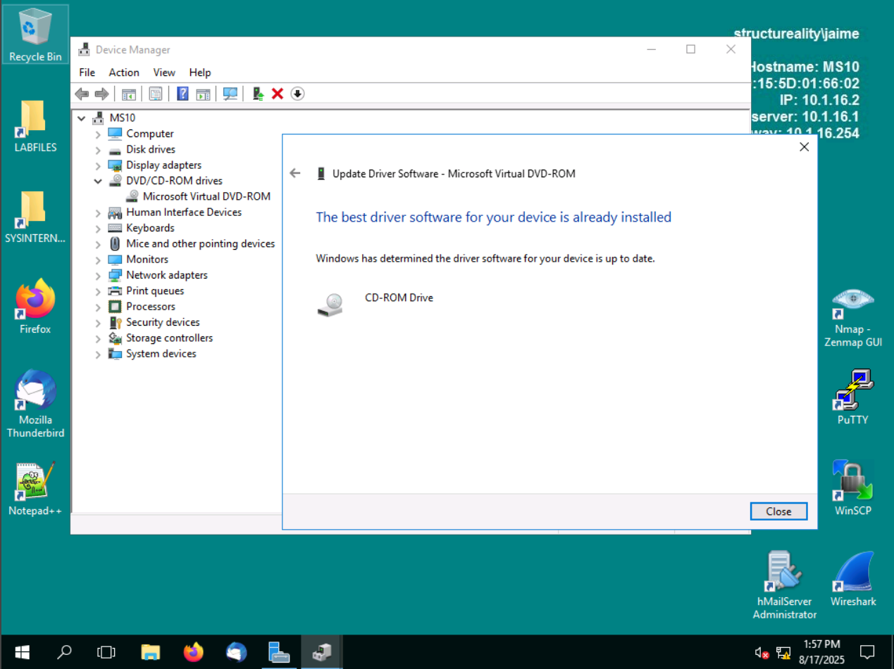  

---

### 2. Manipulating Hosts File on Linux
Next, I jumped into the **Kali VM** to mess with DNS resolution using the `/etc/hosts` file. This is something attackers abuse, but defenders can also leverage it for hardening.

- First, I ran `wget juiceshop.local` to see how it resolved. It hit the correct IP (203.0.113.228), and I saw the `index.html` file downloaded.  
- Checked the `/etc/hosts` file — and yes, it had an entry for `juiceshop.local`.  

  
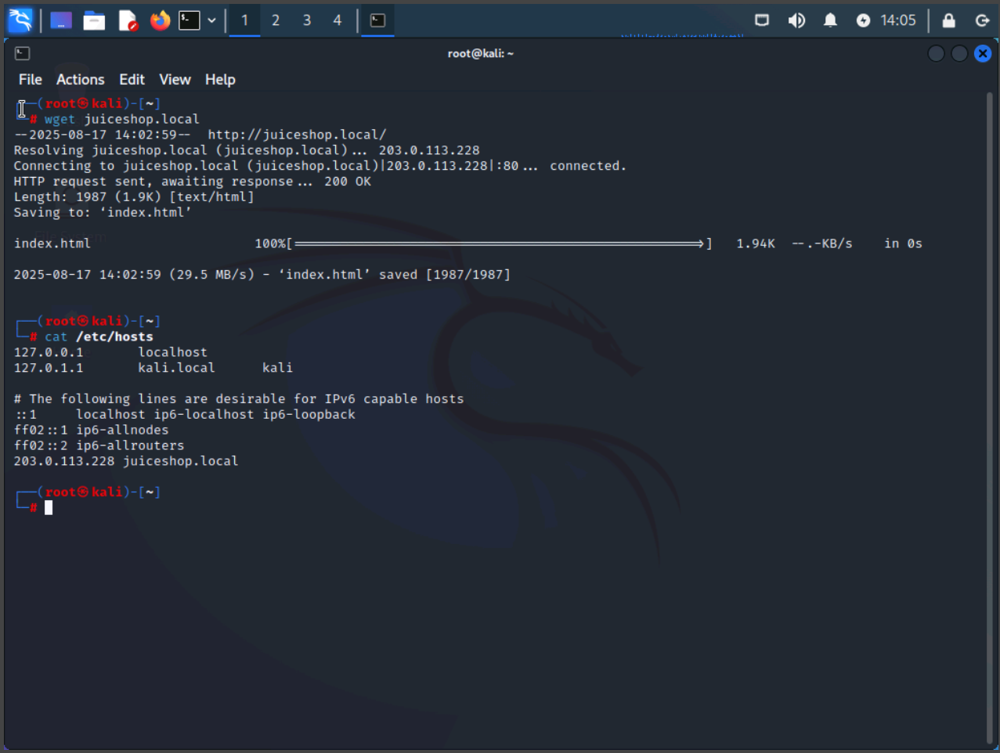  

- Then I purposely **broke it** by editing the hosts file in nano, changing the IP to `203.0.113.249`.  
- Retested with `wget` → as expected, the connection failed because the system was now resolving to a bad IP.  

  
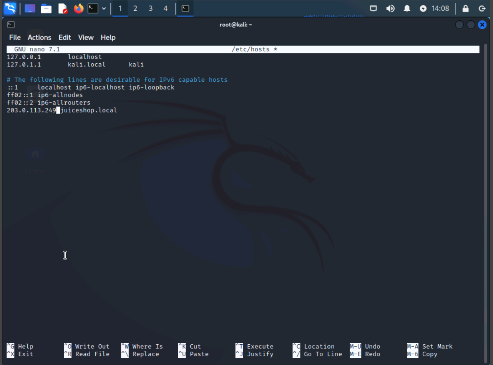  

- Finally, I fixed it again — set it back to the right IP (`203.0.113.228`) and confirmed with another `wget`. This time it connected and downloaded `index.html.1`.  

  
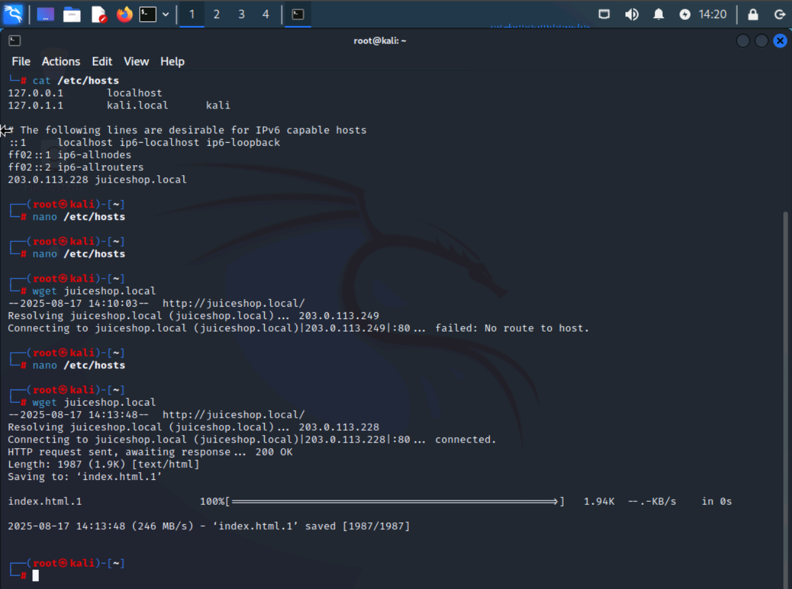

**Takeaway**: In this VM, the local hosts entry took precedence for the tested request. Resolver order and application behavior matter; `/etc/hosts` is not a universal override for every DNS client. A bad local mapping can break a service even when the network is otherwise reachable.

---

### 3. Removing Unneeded Applications and Services
Another big part of hardening is simple: **get rid of junk**. Every unnecessary app or service is just another attack surface. On the **MS10 server**, I did two things:

1. **Removed CPUID CPU-Z**  
   - Opened **Programs and Features**  
   - Selected CPUID CPU-Z and uninstalled it — since this tool wasn’t needed in production.  
   - Confirmed it was completely removed.  

  
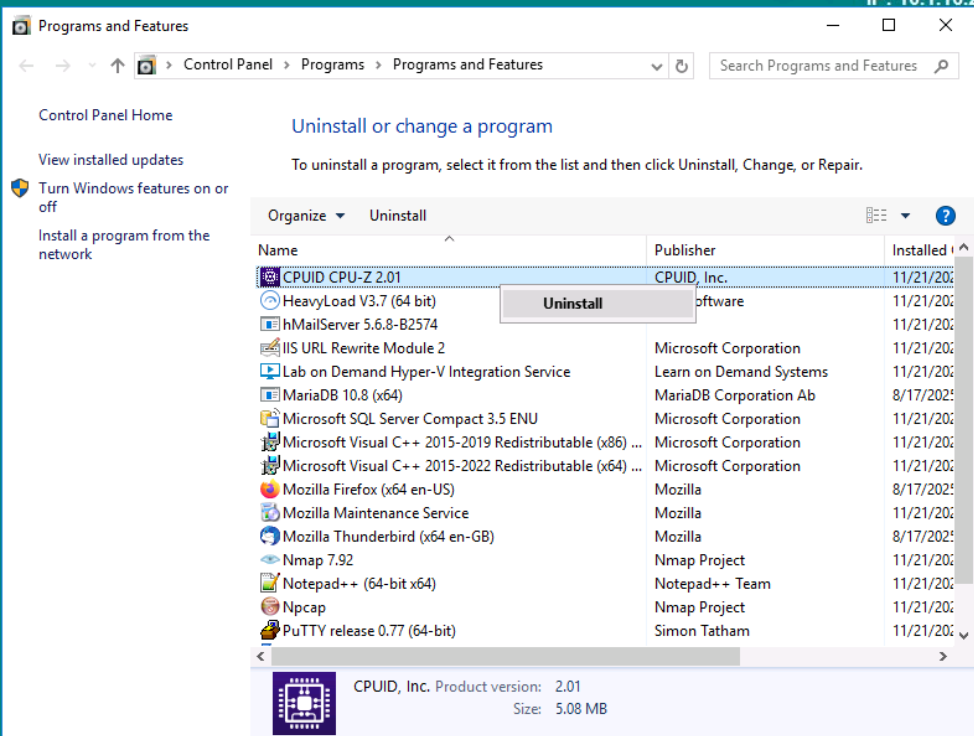  

2. **Removed the insecure FTP service**  
   - Launched **Server Manager** → *Remove Roles and Features*.  
   - Selected the **FTP Server** role and removed it.  
   - Followed the role-removal workflow; the screenshot captures FTP service removal in progress.

  
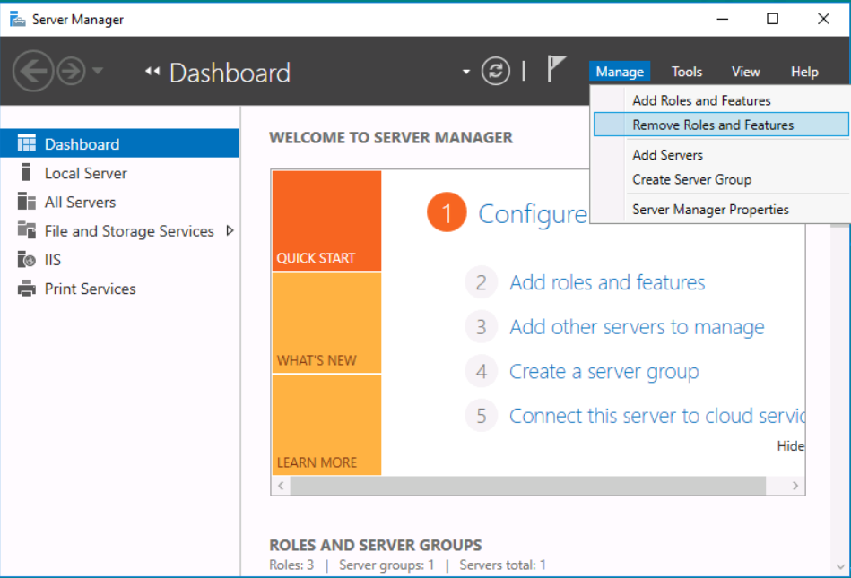  
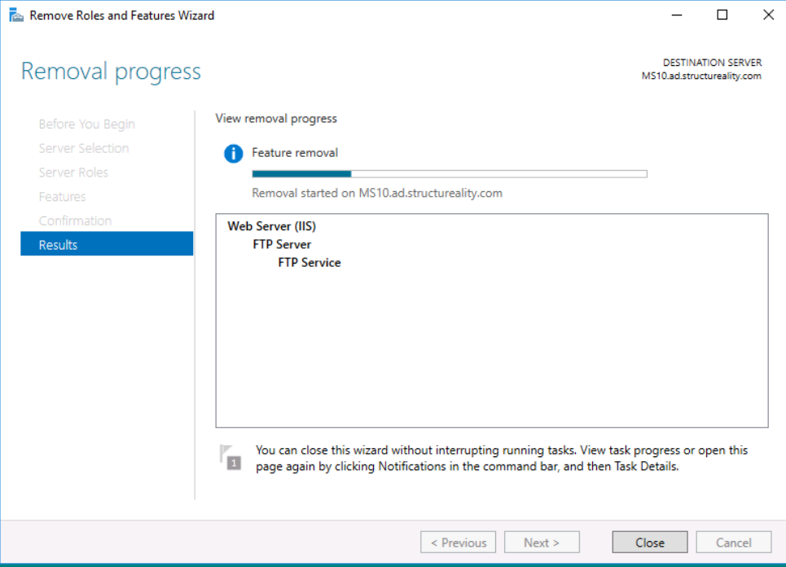  

**Takeaway**: It’s easy to forget about “harmless” tools and leftover services, but attackers love exploiting those. Hardening is just as much about subtraction as addition.

---

### 4. Hardening with Firewall Rules (ICMP Blocking)
Next came the firewall work. The requirement was to **block ICMP traffic** between DC10 and PC10. Here’s how it went:

- First test: from **PC10**, I pinged **DC10**. Replies came back instantly.  
  
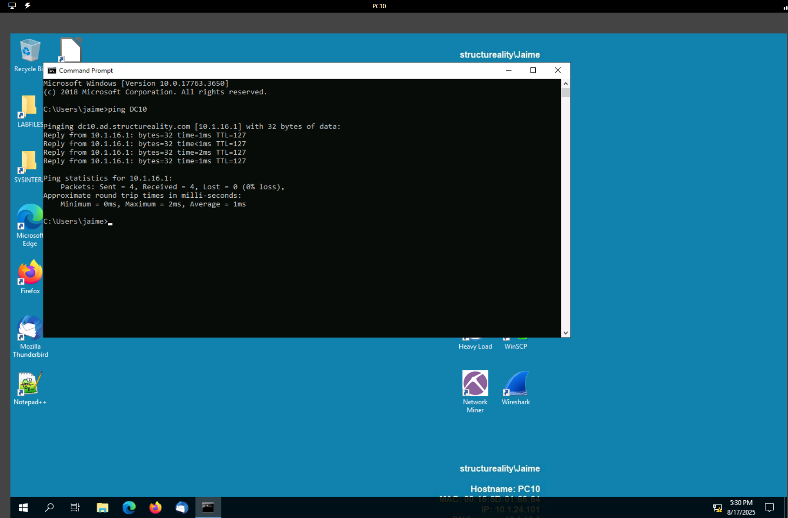  

- Second test: from **DC10**, I pinged **PC10**. As expected, PC10’s firewall was already blocking ICMP — all I got were timeouts.  
  
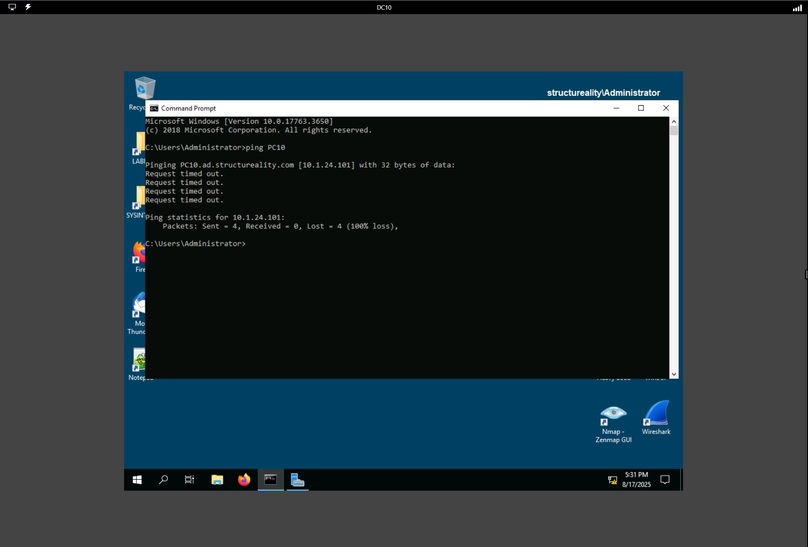  

The tests showed different ICMP echo behavior in each direction. A timeout alone does not establish that PC10 is secure or identify every possible cause; the next step was to configure the intended inbound echo filtering on DC10.

- I opened **Windows Defender Firewall with Advanced Security** on DC10.  
- Located the inbound rule for **File and Printer Sharing (Echo Request - ICMPv4-In)** and set it to **Block the connection**.  
- Also reviewed the corresponding ICMPv6 rule as part of the exercise; the captured rule and ping test below show ICMPv4.

  
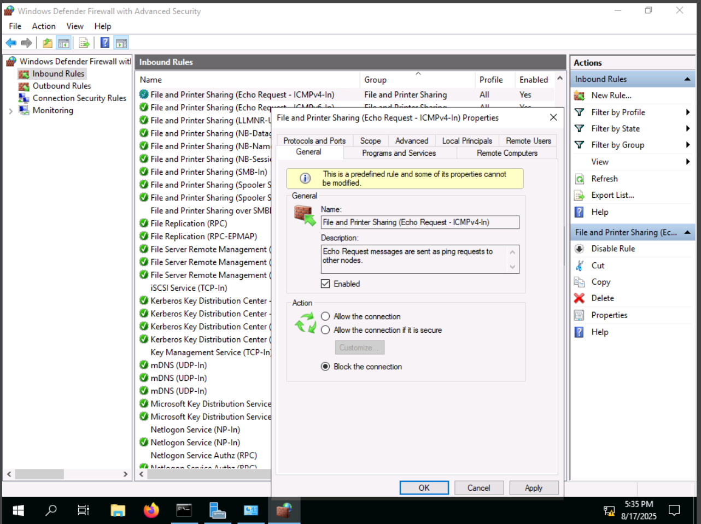

- After applying the rule, I retested the ping from PC10 to DC10 — this time, total silence: all requests timed out. Exactly what I wanted.  

 
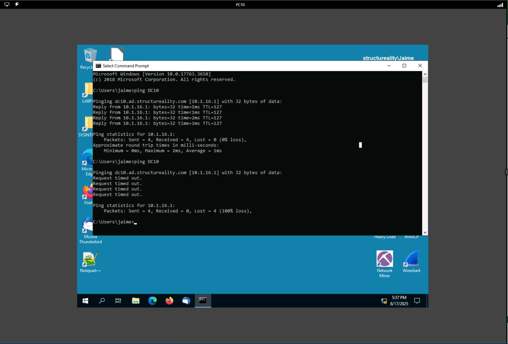

**Takeaway**: Disabling one allow rule does not create an explicit block. For conflicting ordinary Windows Firewall rules, an explicit block takes precedence over an allow. Scope, active profile, policy, and authenticated bypass rules also matter. This test verified the intended ICMPv4 echo filtering result, not complete endpoint security.

---

### 5. Setting File Permissions on Linux
Finally, I went back into the **Kali machine** to tackle Linux file permissions. This part was all about using both **symbolic** and **octal** notation to harden files.

- I started with **demofile.sh**, which had overly broad access.  
- Using `chmod 710 demofile.sh`, I locked it down so the **owner had full control, the group could only execute, and others had no access**.  
- Verified with `ls -l` → it showed exactly as `-rwx--x---`.  

  
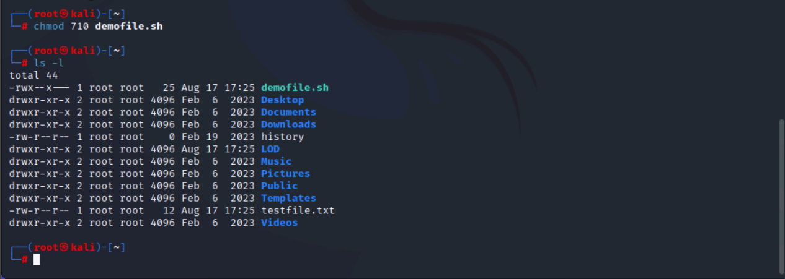

---

Next, I practiced with **testfile.txt** using **symbolic notation**:  
- `chmod u+x testfile.txt` → gave execute to the owner.  
- `chmod g+w testfile.txt` → gave write to the group.  
- `chmod go-r,u-x testfile.txt` → took away read from group/others and execute from owner.  
- Each time I confirmed the changes with `ls -l`.  

  
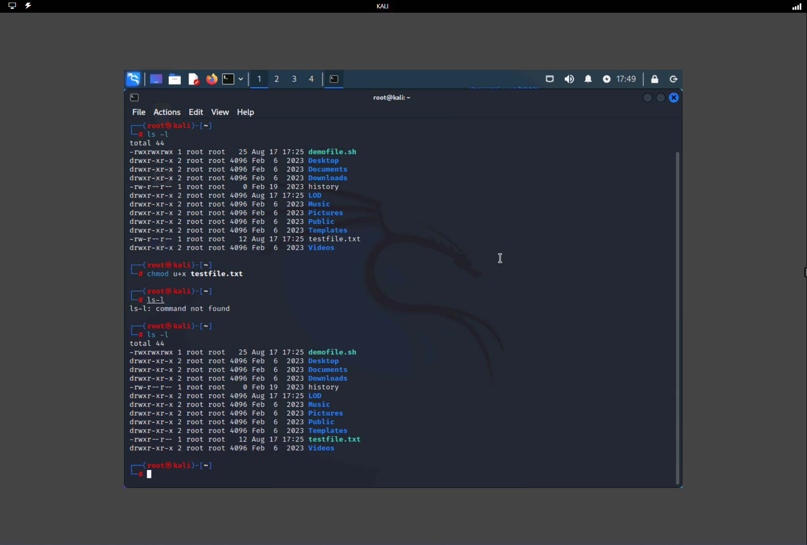
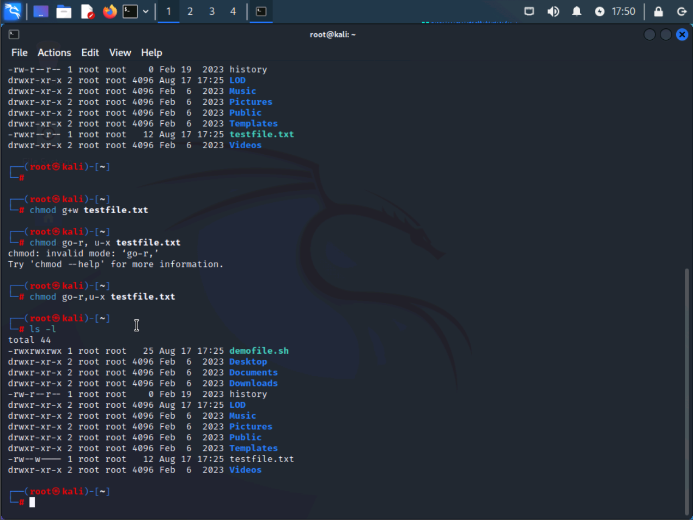

I corrected a malformed command before applying `chmod go-r,u-x testfile.txt`. Reading the error and checking the resulting permissions was part of the exercise.

---

Finally, I used **octal notation** to apply common permission sets:  
- `chmod 777 testfile.txt` → full access for everyone.  
- `chmod 644 testfile.txt` → owner read/write, group read, others read. This can suit nonsensitive files, but private data may need a more restrictive mode such as `600`.
- Watched the file flip between wide-open and properly restricted.  

  
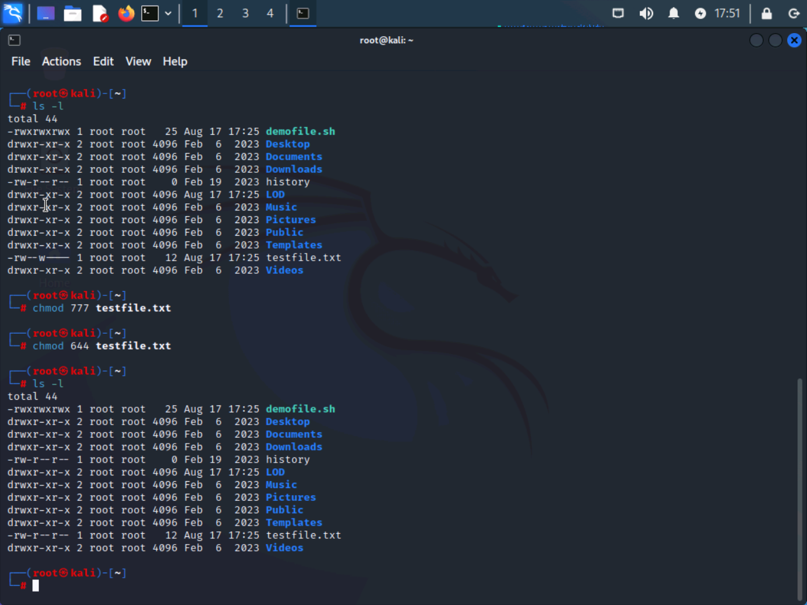

**Takeaway**: Playing with these permissions reminded me how small changes (a single `+x` or `-r`) can completely change who has control over a file. In the wrong hands, a lazy permission setting can expose sensitive scripts to everyone on the system.

---

## Lessons Learned
- **System hardening is iterative** — update, remove, validate, repeat. It’s not glamorous, but it’s the bread-and-butter of keeping systems safe.  
- Even simple things like a **hosts file entry** or a **forgotten service** can be exploited if left unchecked.  
- **Windows Firewall** taught me to distinguish disabling an allow rule from adding an explicit block, then validate the traffic covered by that rule.
- **Linux permissions** gave me muscle memory with both symbolic and octal notation, which is essential for quick hardening in production environments.  

---

## Practical Value
What struck me most about this lab is how “ordinary” tasks — uninstalling a tool, editing a text file, blocking ping — are actually the frontline of defense in real organizations.  
It’s not always about flashy tools or AI-driven detection. Sometimes, it’s literally about **removing what you don’t need, tightening what you do, and verifying at each step**.  

For me, this wasn’t just about checking boxes to complete a lab. It was a reminder that in IT support and security work, these habits matter: chasing down misconfigurations, cleaning up loose ends, and documenting the process so others can trust the systems I’ve hardened.

---

## MITRE ATT&CK Mapping
- [T1222: File and Directory Permissions Modification](https://attack.mitre.org/techniques/T1222/)

> **Author:** Komiljon Karimov 
> **Mission:** Reliable technology and informed security decisions

[Back to portfolio](../../README.md) · [Domain index](../README.md)
