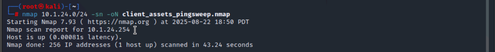
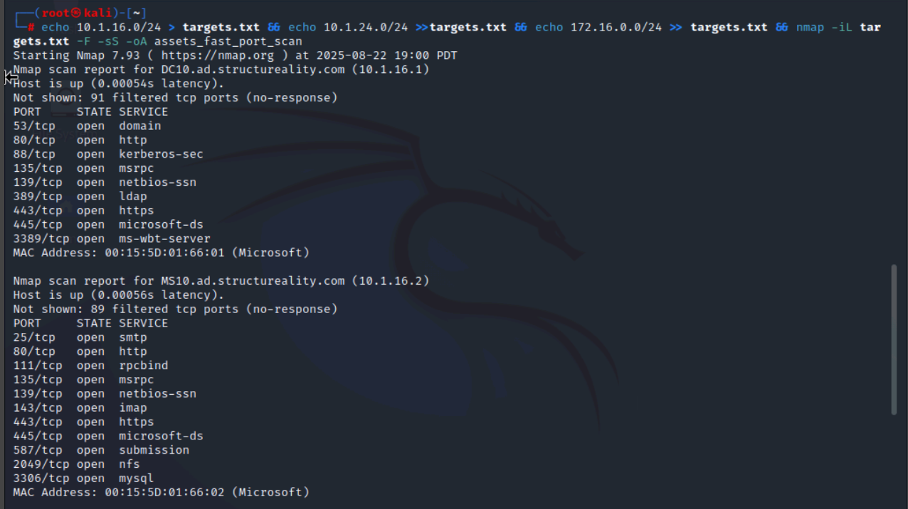
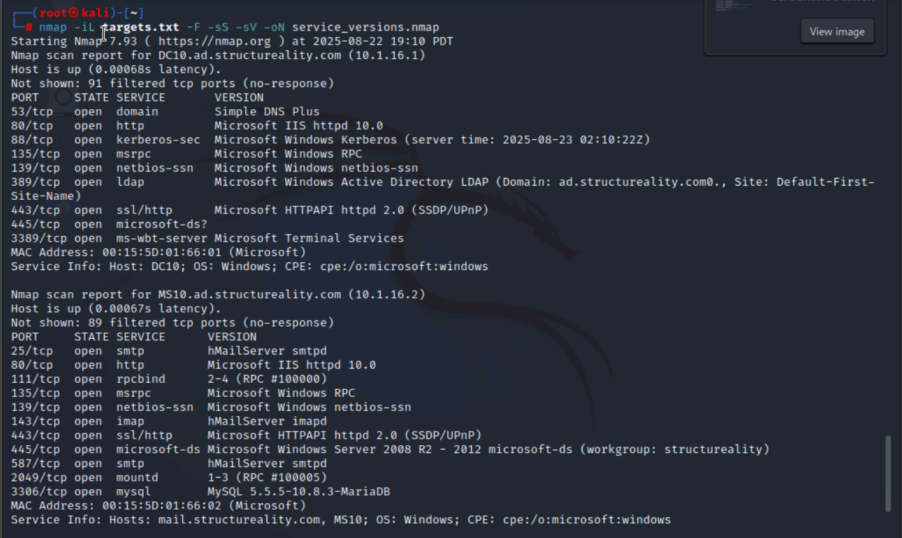
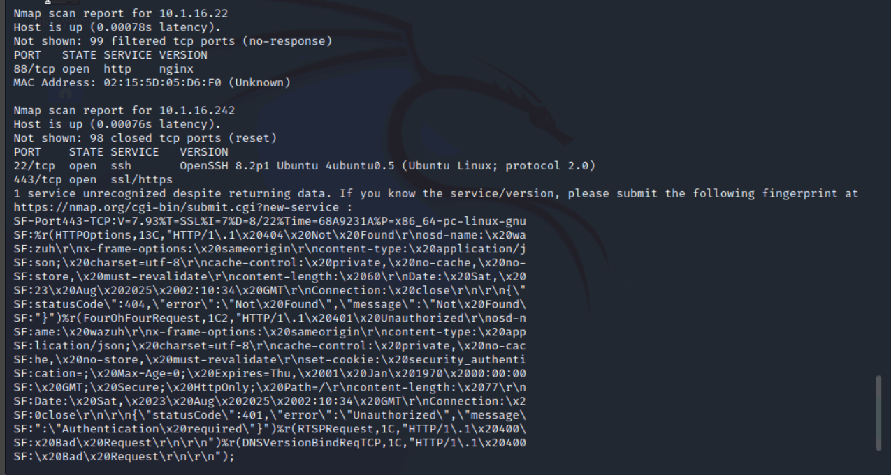
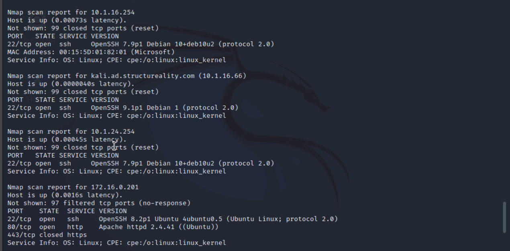
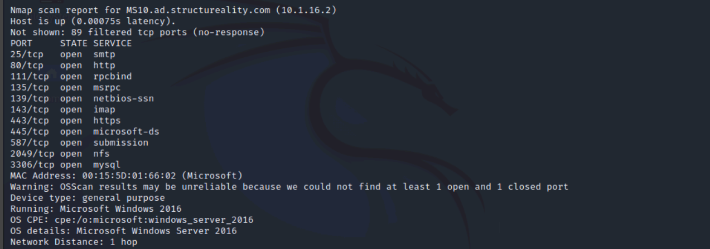
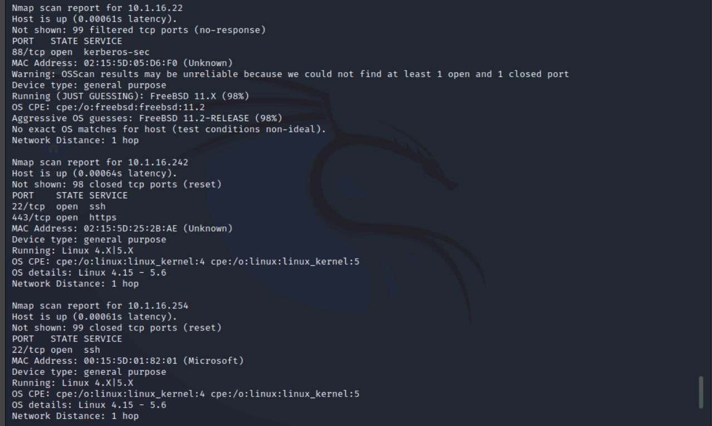
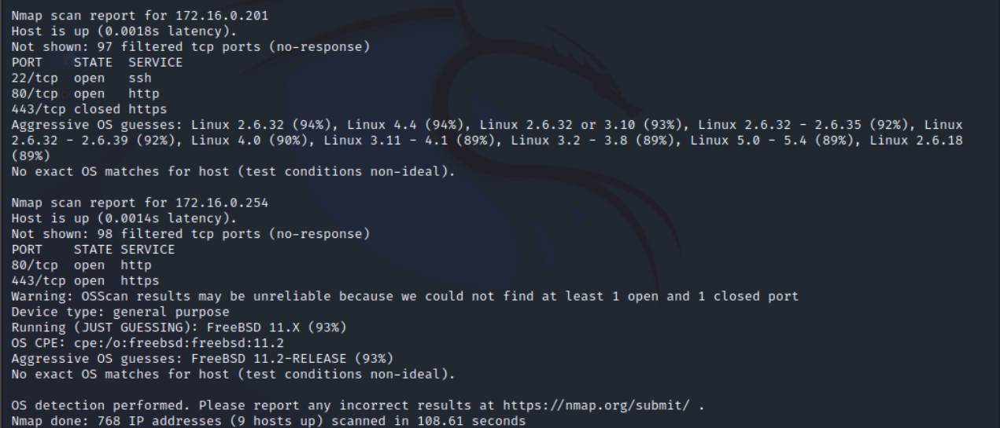
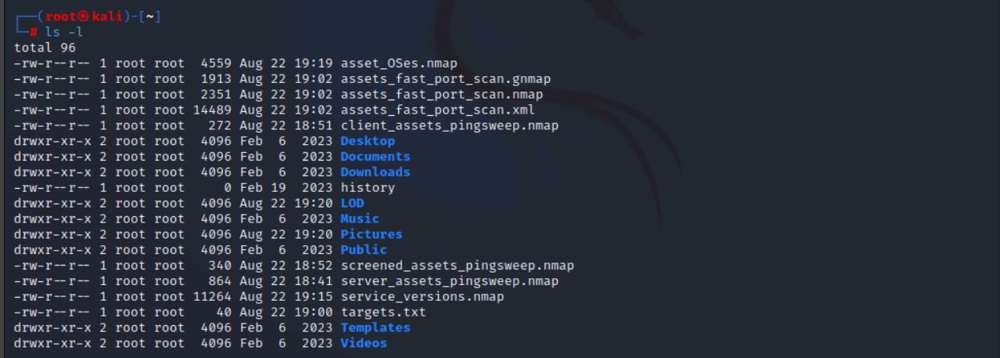

# Lab 01: Performing Asset Discovery with Nmap

[Portfolio](../../README.md) / [Network Security](../README.md)

[Overview](#overview) · [Objectives](#objectives) · [Environment & Tools](#environment--tools) · [What I Did](#what-i-did) · [Evidence](#evidence) · [Lessons Learned](#lessons-learned) · [Practical Value](#practical-value)

## Overview

I used Nmap in a controlled training network to discover hosts and inspect services across server, client, and screened subnets. I compared discovery methods, saved scan outputs, and reviewed service information and OS fingerprints to build a clearer inventory.

## Objectives

Practice repeatable asset discovery and interpret its limits. Comparing scan results with an approved inventory can help identify unexpected devices; identifying a host as unauthorized requires that inventory and operational context.

Subnets scanned:  
- **Server subnet:** `10.1.16.0/24`  
- **Client subnet:** `10.1.24.0/24`  
- **Screened subnet (DMZ):** `172.16.0.0/24`  

## Environment & Tools
- **Kali Linux (root terminal)**  
- **Nmap 7.93**  

## What I Did

1. **Ping Sweeps**  
   - Used `nmap -sn` to detect live hosts across each subnet.  
   - Saved results into `.nmap` output files.  

   <br>

2. **SYN Fast Port Scan**  
   - Created `targets.txt` with all three subnets.  
   - Ran a **top-100 TCP port SYN scan** using:  
     ```bash
     nmap -iL targets.txt -F -sS -oA assets_fast_port_scan
     ```
   - Captured results in `.nmap`, `.gnmap`, `.xml`.  

     
     

3. **Version Detection (Service Enumeration)**  
   - Ran version scans on discovered hosts to identify running services and applications:  
     ```bash
     nmap -iL targets.txt -F -sS -sV -oN service_versions.nmap
     ```
   - Identified services like **DNS, HTTP, Kerberos, LDAP, SMTP, IMAP, MySQL, SSH**.  

     
     

4. **OS Detection**  
   - Used OS fingerprinting with:  
     ```bash
     nmap -iL targets.txt -F -sS -O -oN asset_OSes.nmap
     ```
   - Reviewed OS fingerprints and candidate matches:
     - **Windows Server 2016**  
     - **Linux kernel 4.x/5.x**  
     - **FreeBSD 11.x**  

   
   <br>
     
   <br>

The OS output includes confidence estimates and warnings about non-ideal scan conditions. I treated the returned versions as candidate identifications to validate against host records, rather than confirmed operating-system versions.

## Evidence
All screenshots are saved in the [`screenshots/`](./screenshots/) folder.  
Each image highlights an important step: ping sweeps, port scans, version scans, and OS detection.  

## MITRE ATT&CK Mapping
- [T1046: Network Service Discovery](https://attack.mitre.org/techniques/T1046/)

## Lessons Learned
- **Host discovery can miss devices** when probes are filtered. Nmap `-sn` uses different probes depending on privileges and network location; it is not limited to an ICMP echo sweep.
- **SYN scans** identify TCP port states without completing a normal application connection. They are still visible to network monitoring and should be run within authorized scope.
- **Version scans** reveal critical service details (e.g., Kerberos, MySQL, IIS) that support inventory review and vulnerability follow-up.
- **OS fingerprinting** helps classify candidate systems; scan conditions and approved inventory determine how confidently I can interpret them.
- This lab reinforced the importance of **layered discovery methods** when validating assets against official inventory.  

---

## Practical Value

I discovered hosts and services across three lab subnets, preserved scan outputs, and learned to separate observed port states from service and OS inferences. This supports network troubleshooting, inventory maintenance, and security analysis.

<p align="center"></p>

> **Author:** Komiljon Karimov<br>
> **Mission:** Reliable technology and informed security decisions

[Back to portfolio](../../README.md) · [Domain index](../README.md)
