# Lab 02 — Passive Traffic Analysis with Wireshark

[Portfolio](../../README.md) / [SIEM & Log Analysis](../README.md)

[Overview](#overview) · [Objectives](#objectives) · [Environment & Tools](#environment--tools) · [What I Did](#what-i-did) · [Evidence & Results](#evidence--results) · [Lessons Learned](#lessons-learned) · [Practical Value](#practical-value)

## Overview

I used Wireshark in a controlled Windows/Linux lab to inspect ICMP and SSH traffic. I generated ping and SSH traffic, checked the effect of an inbound firewall rule, compared visible ping payloads, and inspected SSH version and algorithm information. Wireshark captured the traffic passively; generating the demonstration traffic was an active part of the exercise.

## Objectives

- Capture traffic and apply display filters.
- Compare successful and unanswered ICMP echo requests.
- Read payload patterns as host-behavior clues.
- Identify SSH software banners and distinguish cleartext setup metadata from encrypted session traffic.

## Environment & Tools

- **Kali Linux VM:** Wireshark 4.0.x, terminal, and OpenSSH server
- **DC10 Windows VM:** command prompt, Windows Firewall, and PuTTY client
- **Recorded lab addresses:** Kali `10.1.16.66`; DC10 `10.1.16.1`

### Optional Local VM Definition

The included [Vagrantfile](Vagrantfile) defines Kali and Windows machines on `192.168.56.10` and `192.168.56.11`. It is a starting VM definition, separate from the recorded training network. It does not install the full course environment or configure the SSH service and firewall exercise.

```bash
vagrant up
```

Reproducing the exercise locally requires the appropriate virtualization provider, available box images, configured services, and commands adjusted for the local addresses. I have preserved the original recorded environment in the walkthrough below.

## What I Did

### 1. Start the Capture

I opened Wireshark on Kali, selected `eth0`, and inspected the packet list, protocol details, and bytes panes.

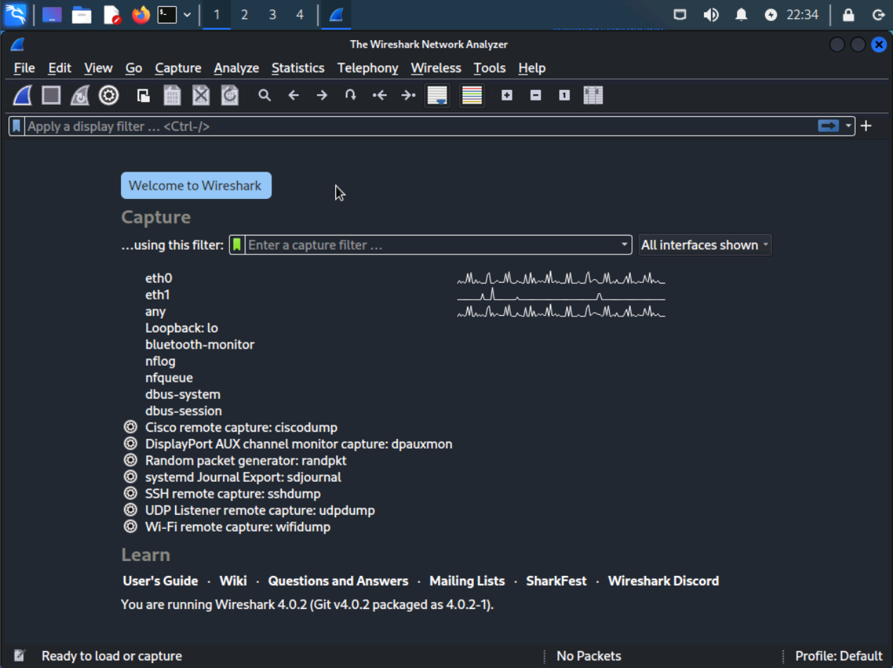
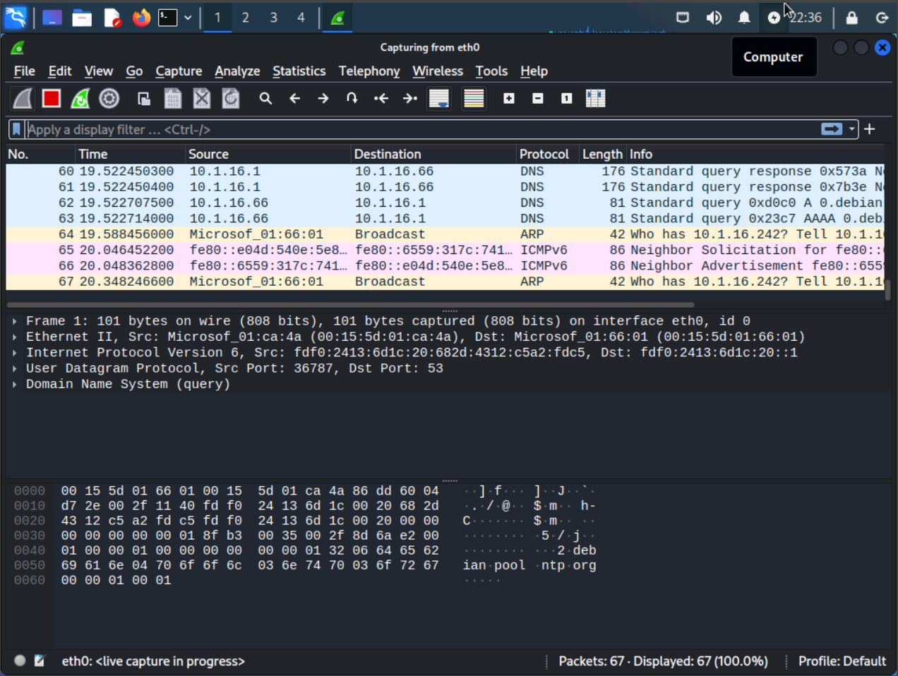

### 2. Check ICMP Connectivity and Filtering

I sent four echo requests from Kali to DC10 and initially received four replies. On DC10, I added an inbound ICMPv4 echo-request block rule. The same Windows screenshot also shows successful ping in the opposite direction, from DC10 to Kali.

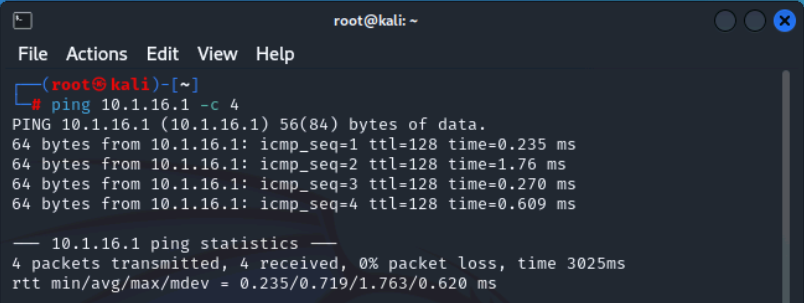
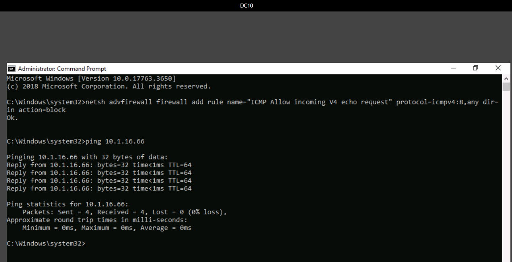

When I repeated the Kali-to-DC10 test, the terminal showed 100% packet loss. I used an ICMP display filter to review the related capture. The filtered view also includes ICMP destination-unreachable messages relating to other traffic, so each message needs to be interpreted by type and direction.

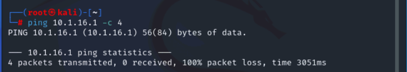
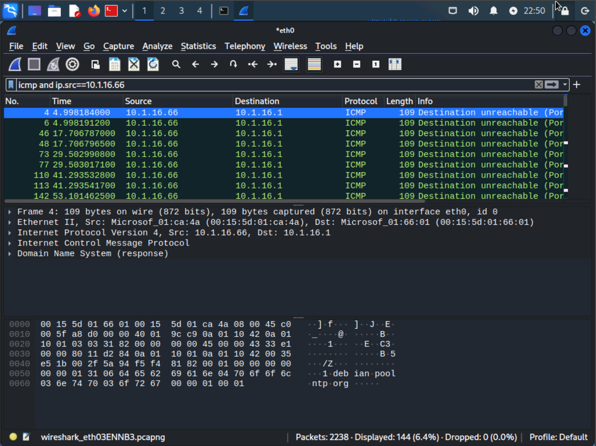

This check established the intended echo-filtering result in that lab configuration. A timeout by itself can also have other causes, so I correlated the command, rule change, and traffic direction.

### 3. Compare Ping Payload Patterns

I compared the visible payloads generated by the two ping utilities:

- Kali's captured echo payload contains timestamp data and a 48-byte data section.
- Windows' captured echo payload contains a 32-byte alphabetic pattern.

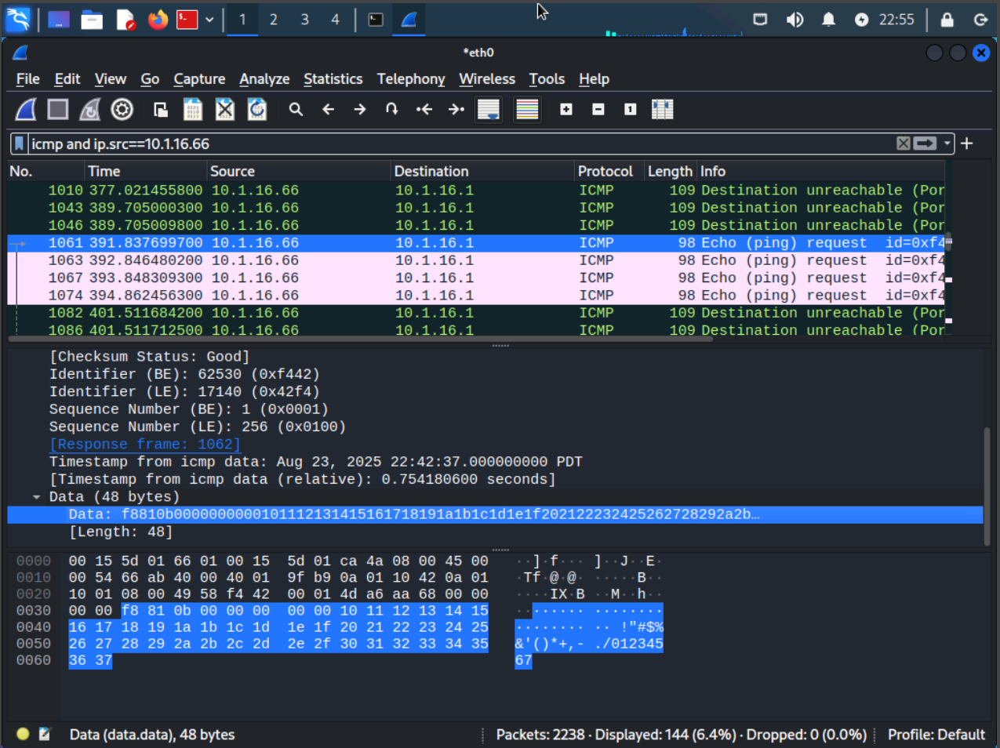
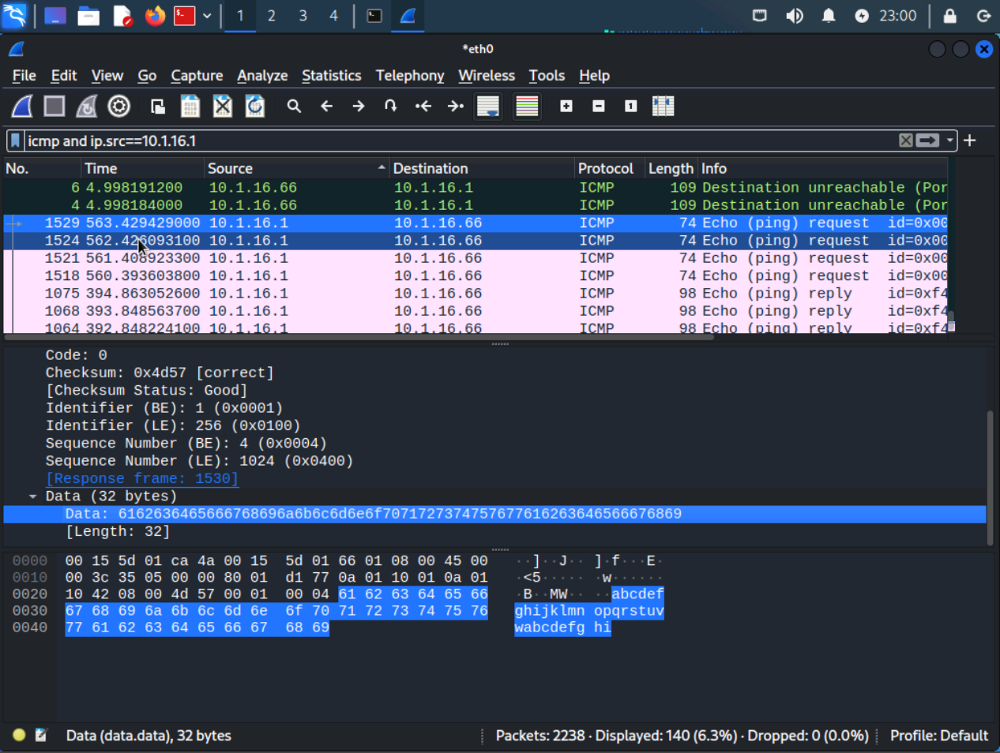

These are useful hints about the generating utility in this exercise. Payloads and packet sizes are configurable, so they do not uniquely identify an operating system.

### 4. Inspect SSH Setup and Encryption Metadata

I used PuTTY on DC10 to connect to Kali over SSH.

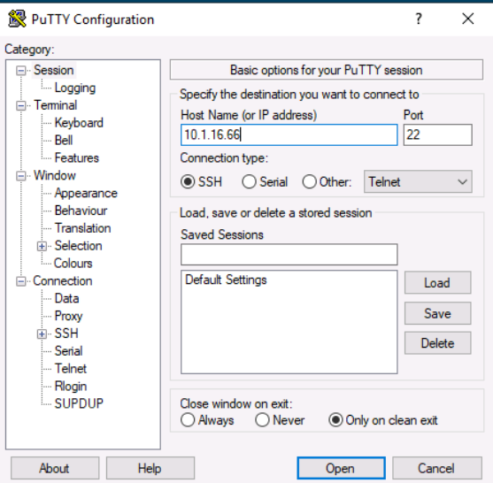

The capture identifies the PuTTY client and OpenSSH server software banners. SSH exposes this setup metadata before encrypted session traffic begins.

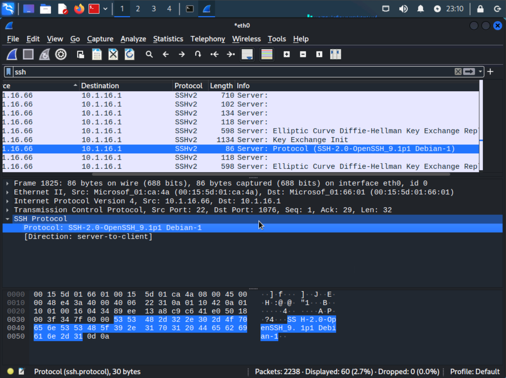
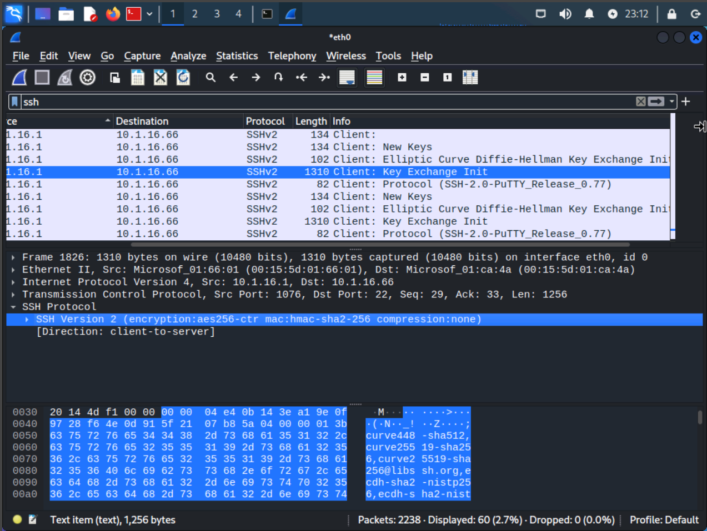

I also inspected SSHv2 packets labelled with `aes256-ctr` encryption, `hmac-sha2-256`, and no compression. The key-exchange proposal lists offered algorithms; that list and an encrypted packet carry different kinds of information.

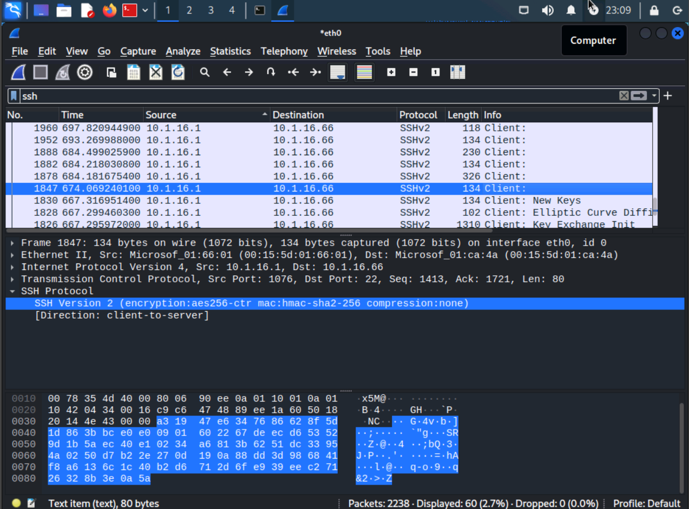

## Evidence & Results

All 12 original images remain available in [screenshots/](screenshots/). They document the capture interface, before/after ping behavior, the firewall command, payload patterns, PuTTY setup, and SSH protocol details.

## MITRE ATT&CK Mapping

- [T1040 — Network Sniffing](https://attack.mitre.org/techniques/T1040/): the lab demonstrates authorized packet inspection and helps explain what a network observer can see.

## Lessons Learned

- Capture filters and display filters serve different purposes; a display filter changes what is shown from the capture.
- Traffic direction matters when checking firewall behavior.
- ICMP payload patterns are clues to correlate with other evidence.
- Encryption protects session contents while leaving some connection and software metadata visible.
- A clear comparison of commands, configuration, and capture details makes troubleshooting easier to review.

## Practical Value

This work connects network troubleshooting with security analysis: establish connectivity, change one control, inspect the resulting traffic, and explain both the observed result and its scope.

<p align="center"></p>

> **Author:** Komiljon Karimov<br>
> **Mission:** Reliable technology and informed security decisions

[Back to portfolio](../../README.md) · [Domain index](../README.md)
