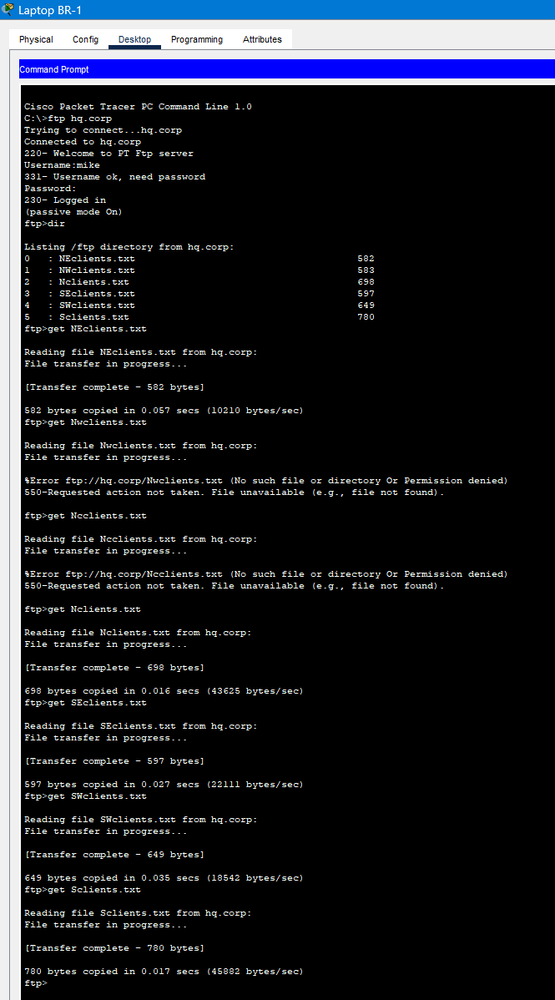
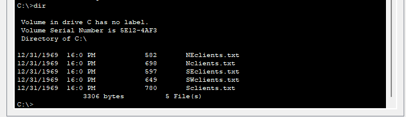
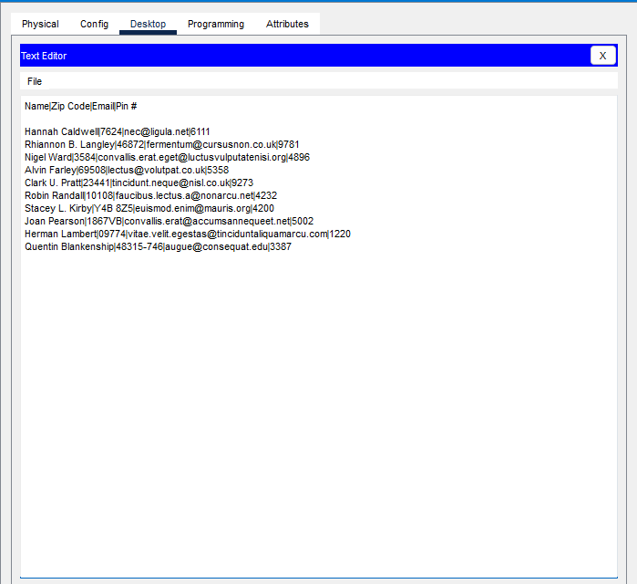
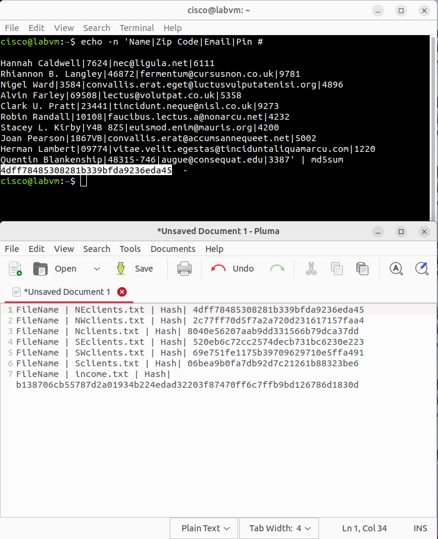
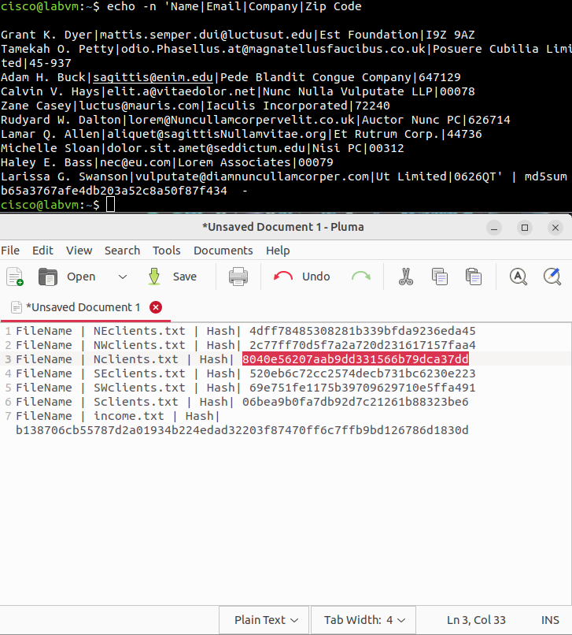
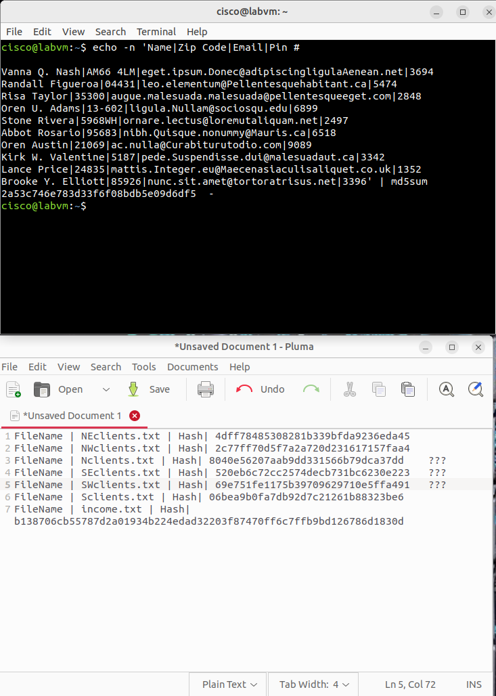
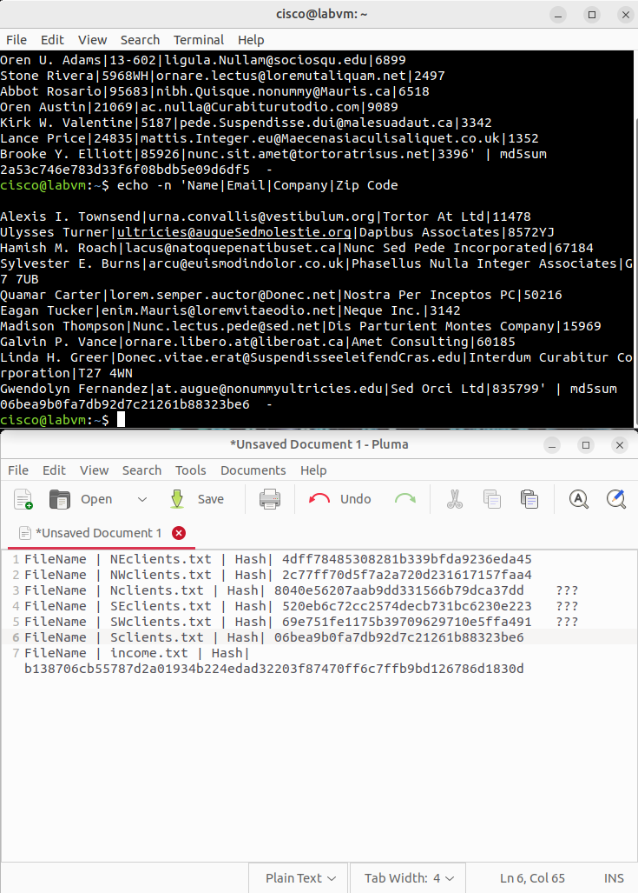
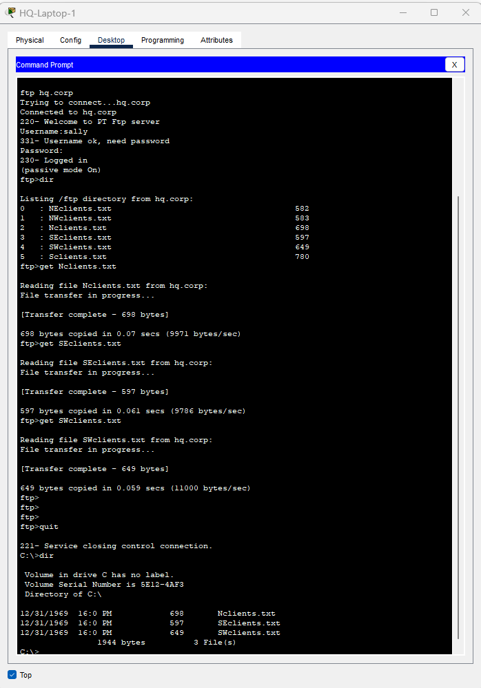
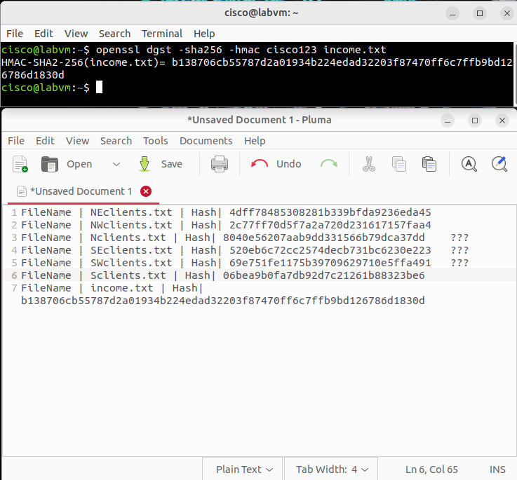

# Lab 01 — File and Data Integrity Checks

[Portfolio](../../README.md) / [Cryptography & Encryption](../README.md)

[Overview](#overview) · [Objectives](#objectives) · [Environment & Tools](#environment--tools) · [What I Did](#what-i-did) · [Evidence & Results](#evidence--results) · [Lessons Learned](#lessons-learned) · [Practical Value](#practical-value)

## Overview

I completed a Cisco Packet Tracer incident-recovery exercise as Mike, a fictional branch employee. I retrieved backup client data, compared copied file contents with supplied reference hashes, escalated suspect files to Sally, and verified an HMAC for a separate financial-data file. The business roles, financial records, and compromised services belong to the training scenario.

## Objectives

- Compare recovered content with a trusted reference before using it.
- Document mismatches and provide suspect files for further investigation.
- Explain how a keyed HMAC differs from an unkeyed digest.

## Environment & Tools

- Cisco Packet Tracer branch/HQ network, browsers, FTP clients, and email
- CSE-LABVM in VirtualBox
- Pluma, `md5sum`, and OpenSSL
- [Original Cisco lab instructions](Lab01_File_Data_Integrity_Checks_lab_instructions.pdf)

## What I Did

### 1. Retrieve reference values and backup data

I visited the branch intranet and observed the exercise's ransomware message. I copied the supplied reference hash list from HQ into Pluma, then used the Packet Tracer FTP client to retrieve the client files for comparison. The transfer sequence includes a filename retry, which is visible in the original capture.

### 2. Compare the client-file contents

I copied text from the downloaded files into the lab VM and used the course's command pattern:

```bash
echo -n 'copied file contents' | md5sum
```

The `NEclients.txt` comparison matches the supplied reference. The captured `Nclients.txt` digest differs from its reference. My notes also flag the SE and SW entries for follow-up, and the supervisor's FTP sequence retrieves `Nclients.txt`, `SEclients.txt`, and `SWclients.txt`.

These comparisons identify content that needs investigation. Because the exercise hashes copied text, exact characters and line endings matter; a mismatch establishes a difference from the reference, with the cause investigated in context. The screenshots preserve the original comparisons rather than supporting an invented count of matching files.

### 3. Escalate and retain the suspect material

I followed the exercise's reporting workflow to notify the supervisor and transferred suspect files to HQ-Laptop-1 for analysis. This kept the evidence and the reason for escalation together.

### 4. Check a keyed SHA-256 HMAC

For the supplied `income.txt` file, I ran:

```bash
openssl dgst -sha256 -hmac cisco123 income.txt
```

The HMAC shown in the terminal matches the reference in Pluma. The command's key is a public classroom value. A matching HMAC supports integrity and origin assurance when the reference is trusted and the secret key remains protected; anyone who knows the key can generate a valid tag.

## Evidence & Results

<details>
<summary><b>Open the complete original integrity-check sequence</b></summary>

| Evidence | Observation |
|---|---|
|  | Simulated incident prompt |
|  | Client-data retrieval |
|  | Files present at this point in the session |
|  | Data used in the comparison |
|  | Matching NE digest |
|  | N comparison requiring follow-up |
|  | Further comparison and investigation notes |
|  | Continued client-data comparison |
|  | Suspect files collected for analysis |
|  | Keyed SHA-256 verification |

</details>

## Lessons Learned

- Verify the reference as well as the recovered file: an attacker who changes both an unkeyed digest and the data can defeat a naive comparison.
- Preserve the exact bytes being checked. Copying text, changing newlines, or adding a trailing newline can change its digest.
- MD5 demonstrates the comparison process in this historical course exercise, but its collision weaknesses make it unsuitable for modern adversarial integrity assurance. Use a suitable modern hash such as SHA-256 with a trusted reference, or a protected-key HMAC where authentication is needed.
- An HMAC provides integrity/authentication under its key; it does not encrypt the file or identify a particular person who shares that key.
- A clear escalation records the mismatch, reference, source data, and next investigation step.

## Practical Value

This lab demonstrates recovery checks, careful handling of evidence, and concise escalation. The same reasoning supports backup verification, software-integrity checks, and troubleshooting unexpected file changes.

## MITRE ATT&CK Context

[T1565 — Data Manipulation](https://attack.mitre.org/techniques/T1565/) provides context for investigating unexpected data changes. The specific incident and client data here are simulated course material.

<p align="center"></p>

> **Author:** Komiljon Karimov<br>
> **Mission:** Reliable technology and informed security decisions

[Back to portfolio](../../README.md) · [Domain index](../README.md)
