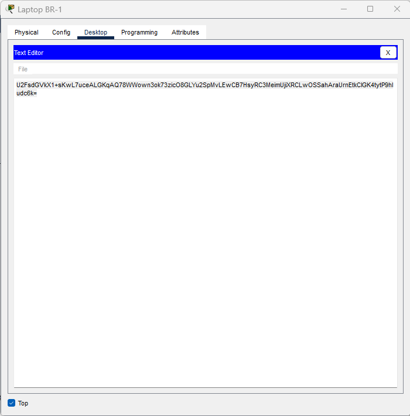
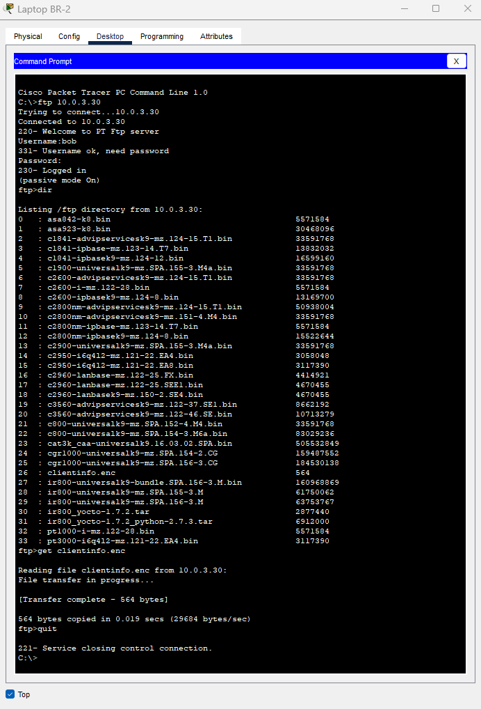
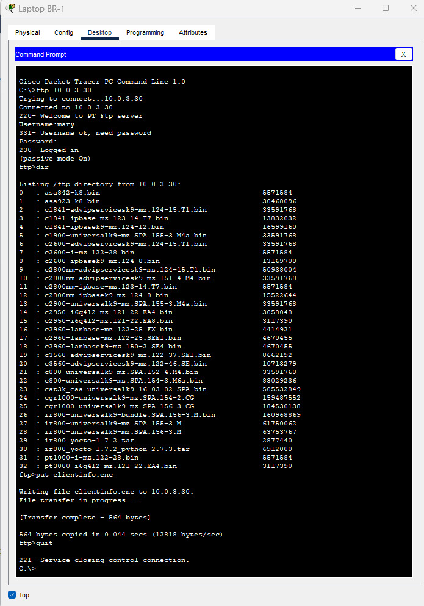
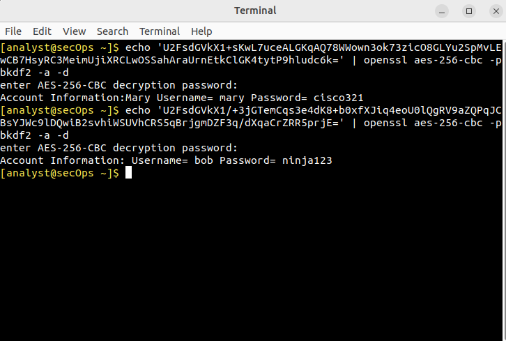
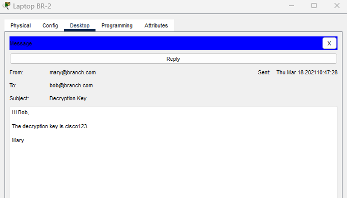
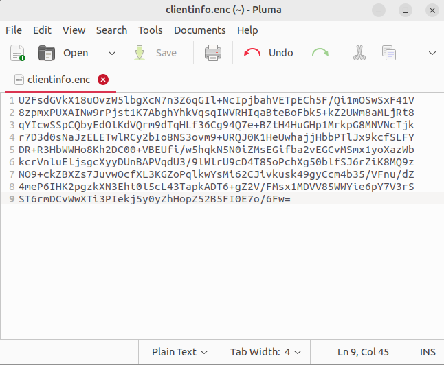
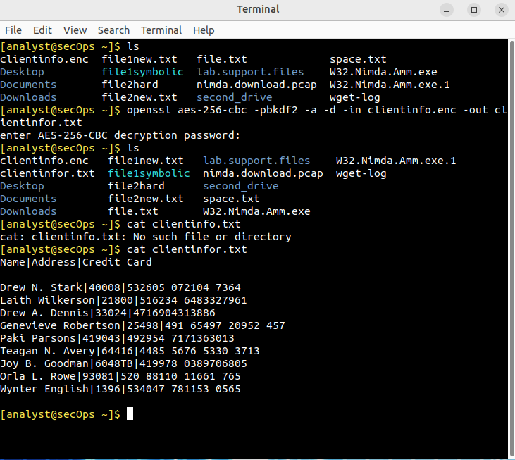

# Lab 02 — File and Data Encryption

[Portfolio](../../README.md) / [Cryptography & Encryption](../README.md)

[Overview](#overview) · [Objectives](#objectives) · [Environment & Tools](#environment--tools) · [What I Did](#what-i-did) · [Evidence & Results](#evidence--results) · [Lessons Learned](#lessons-learned) · [Practical Value](#practical-value)

## Overview

I completed a Cisco Packet Tracer file-exchange exercise using the fictional employees Mary and Bob. I decrypted their provided FTP credentials, transferred an encrypted client-data file, retrieved the supplied password, and recovered the plaintext in a Linux VM. This connects file confidentiality with the practical handling of credentials, keys, and transfers.

## Objectives

- Use OpenSSL to decrypt the course's password-protected data.
- Follow the sender/recipient transfer workflow and verify readable output.
- Distinguish encrypted file contents, transport protection, and integrity verification.

## Environment & Tools

- Cisco Packet Tracer branch network and FTP server
- CSE-LABVM, OpenSSL, and Pluma
- AES-256-CBC with PBKDF2 password derivation and Base64 formatting
- Public training credentials and synthetic client data

## What I Did

### 1. Decrypt the provided credentials

I copied Mary's and Bob's supplied ciphertext into the lab VM and used the provided passwords with this OpenSSL command pattern:

```bash
openssl aes-256-cbc -pbkdf2 -a -d
```

Using the supplied `maryftp123` and `bobftp123` passwords revealed the exercise accounts `mary` / `cisco321` and `bob` / `ninja123`. The public classroom passwords are part of the scenario rather than a credential-storage pattern for production.

### 2. Transfer the encrypted file

I used the FTP accounts to follow the sender/recipient workflow for `clientinfo.enc`. The original FTP screenshots show Mary's and Bob's sessions retrieving the file from the branch server. I also opened the `.enc` file to inspect its Base64-formatted encrypted content.

### 3. Retrieve the supplied decryption password

Bob's simulated inbox contains Mary's message with the classroom password `cisco123`.

### 4. Decrypt and inspect the client data

The captured command uses the output filename `clientinfor.txt`:

```bash
openssl aes-256-cbc -pbkdf2 -a -d -in clientinfo.enc -out clientinfor.txt
```

After correcting a filename mismatch in the `cat` command, I displayed the readable output. It contains the exercise's client names, addresses, and card-like values.

## Evidence & Results

<details>
<summary><b>Open the complete original encryption sequence</b></summary>

| Evidence | Observation |
|---|---|
|  | Ciphertext before credential decryption |
|  | Recipient-side transfer |
|  | Sender-side transfer session |
|  | Decrypted training-account details |
|  | Password-delivery step |
|  | Encrypted file content |
|  | Successful plaintext recovery |

</details>

The result demonstrates successful decryption of the transferred file. File encryption can protect the payload's confidentiality, while plain FTP still exposes account credentials and transfer metadata. A production transfer also needs protected transport and an integrity/authentication mechanism.

## Lessons Learned

- **Encryption and encoding serve different purposes.** AES encrypts the content; Base64 makes the binary data text-friendly and adds no secrecy.
- **Password strength and derivation matter.** PBKDF2 is a password-based derivation function, not inherently a weak KDF. Its work factor and the password's strength affect resistance to guessing; the short published lab passwords are unsuitable for production.
- **CBC encryption alone does not authenticate the file.** Successful decryption is not an integrity check. Use an authenticated encryption format or a properly designed encryption-and-MAC scheme supported by the chosen tooling.
- **Choose derivation tools for the right input.** HKDF is suited to deriving keys from existing key material; it does not replace a password-hardening KDF for weak human passwords.
- **Key delivery needs its own protection.** Sending a password by email is not automatically a secure independent channel. Assess the mailbox, recipient identity, and the key's lifecycle.
- **Protect the transfer and local copies.** Use an appropriate authenticated encrypted transport, restrict access to plaintext, and define retention/deletion requirements.

## Practical Value

This exercise demonstrates a complete decryption workflow and the ability to explain what each layer does. That distinction helps when supporting secure transfers and reviewing how a team handles sensitive files.

## MITRE ATT&CK Context

[T1027 — Obfuscated Files or Information](https://attack.mitre.org/techniques/T1027/) describes adversarial uses of concealment. Here, encryption is an authorized confidentiality exercise; interpreting encrypted content requires the surrounding context.

<p align="center"></p>

> **Author:** Komiljon Karimov<br>
> **Mission:** Reliable technology and informed security decisions

[Back to portfolio](../../README.md) · [Domain index](../README.md)
