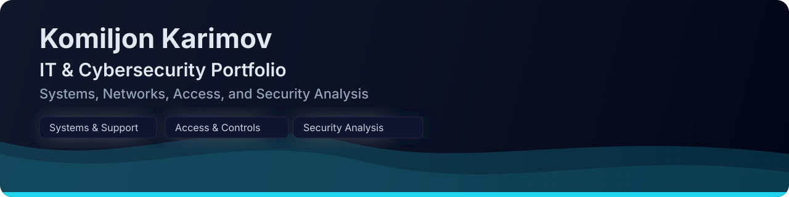
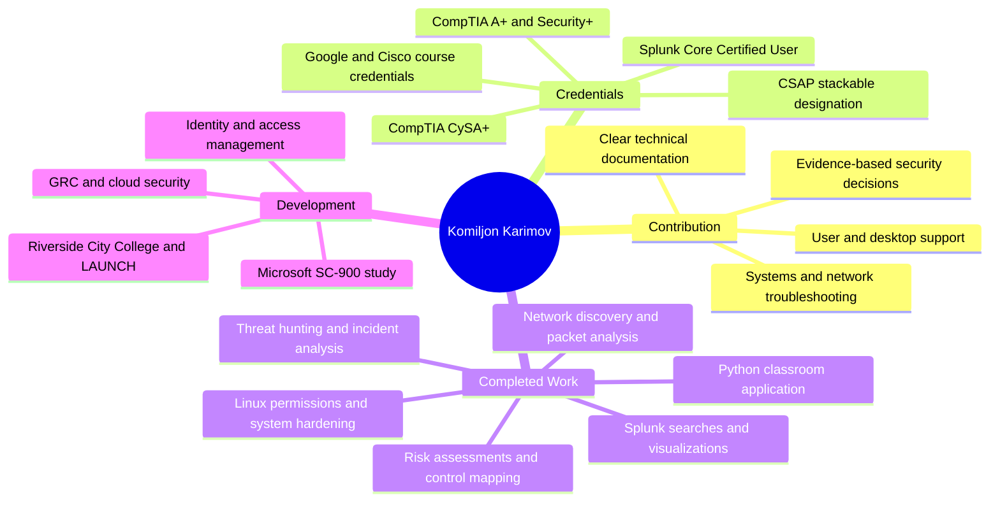

<!-- Banner -->

  

# IT & Cybersecurity Portfolio

  <a href="https://www.linkedin.com/in/komiljon-karimov"><b>LinkedIn</b></a>

  <b>Systems, Networks, Access, and Security Analysis</b> 
  Ontario, CA | Inland Empire • Greater Los Angeles • Orange County • Broader opportunities

  I troubleshoot technology, document what I find, and use evidence to make informed security decisions.

  

[Capability guide](#capability-guide) · [Featured labs](#featured-labs) · [Full lab index](#full-lab-index-by-domain) · [Credentials](#certifications--training) · [Contact](#contact)

## About Me

I am Komiljon Karimov. My background in engineering, teaching, technical consulting, and practical IT support shapes how I work: understand the problem, check the evidence, explain the next step, and document the result.

This portfolio connects reliable systems and networks with appropriate access and informed security decisions. It includes my completed Windows and Linux labs, network investigations, Splunk analysis, risk assessments, and Python work, with source code, documents, and screenshots for readers who want to examine the details.

I completed the Per Scholas Cybersecurity Program and hold CompTIA A+, Security+, CySA+, and Splunk Core Certified User certifications. I am continuing cybersecurity and apprenticeship-related study through Riverside City College and LAUNCH. My ongoing Microsoft SC-900 study supports my longer-term interests in identity and access management (IAM), GRC, and cloud security.

  

## Career Direction

I am looking for opportunities to support users, troubleshoot systems and networks, and help teams manage access and technology reliably. I also welcome suitable junior security, risk, and audit opportunities that draw on my analytical work and documentation.

I value the daily work of IT support: helping people get back to work, resolving recurring issues, and making technical information easier to use. My security training adds a practical perspective on permissions, configuration, risk, and controls. IAM, GRC, and cloud security are longer-term areas of development; the evidence here shows my current foundation.

  

## Current Highlights

- **Exam certifications:** CompTIA A+, Security+, CySA+, and Splunk Core Certified User
- **Completed analysis:** Splunk searches and visualizations, packet analysis, threat hunting, vulnerability assessment, and scenario-based risk/control reviews
- **Systems and access practice:** Linux permissions, Windows/Linux hardening, network discovery, hashing, and encryption
- **Completed Python project:** a classroom keyboard-monitoring application with a visible interface, session logging, and safe automated validation
- **Practical staff support:** Windows 10/11, basic Office/Microsoft 365 support, printers, cameras, desktop setup, device connectivity, websites, and basic networking at 4Prep Academy

  
<b>Open IT & Cybersecurity Profile Map</b>

  

## Capability Guide

| Explore | Start here | Evidence and scope |
|---|---|---|
| **Systems, networks & troubleshooting** | [System hardening](02_Linux_Windows_Security/Lab03_Performing_System_Hardening) · [Asset discovery](03_Network_Security/Lab01_Asset_Discovery) · [Packet analysis](04_SIEM_Log_Analysis/Lab02_Passive_Scanning_Wireshark) | Lab configuration, command outputs, network observations, and practical troubleshooting reasoning |
| **Access control & automation** | [Linux permissions](02_Linux_Windows_Security/Lab01_LinuxPermissions) · [File permissions](02_Linux_Windows_Security/Lab04_File_Permissions) · [Python project](07_Scripting_Automation/Python/Keylogger) | Local file access, least-privilege reasoning, application structure, session handling, and tests |
| **Security analysis, risk & controls** | [Splunk analysis](04_SIEM_Log_Analysis/Lab07_Splunk_Statistical_Processing) · [Botium Toys assessment](01_GRC_Compliance/Lab02_Botium_Toys_Risk_Assessment) · [NIST CSF analysis](01_GRC_Compliance/Lab03_Applying_NIST_CSF) | Completed technical and scenario-based analysis, findings, control gaps, and recommendations |

## Reading the Evidence

Each lab explains its context, the work I completed, the supporting artifacts, and the lessons I took from it. Use the domain indexes for a quick overview, then open the walkthroughs and original screenshots or documents to examine the details. Course-provided scenarios and recommendations are identified where they appear.

## What This Portfolio Demonstrates

| Area | Evidence Shown |
|---|---|
| **Systems & Local Access** | Linux permissions, Windows/Linux configuration, hardening exercises, and access-control analysis |
| **Networks** | Wireshark packet analysis, Nmap asset discovery, protocol filtering, and network documentation |
| **Risk & Controls** | Course-based assessments, asset review, NIST CSF mapping, control gaps, and recommendations |
| **Splunk & Log Analysis** | Searches, dashboards, reports, alerts, field extraction, statistical processing, and incident notes |
| **Threat & Incident Analysis** | Host observations, IOC review, vulnerability analysis, incident journals, and investigation reasoning |
| **Scripting & Documentation** | Python source code, synthetic test data, reproducible validation, and step-by-step lab explanations |

  

## Portfolio Map

- [**01 — GRC & Compliance**](01_GRC_Compliance) — scenario-based risk assessment, controls, and framework analysis
- [**02 — Linux & Windows Security**](02_Linux_Windows_Security) — local permissions, logging, and system hardening
- [**03 — Network Security**](03_Network_Security) — Nmap discovery and network visibility
- [**04 — SIEM & Log Analysis**](04_SIEM_Log_Analysis) — Splunk, Wireshark, searches, reports, and visualizations
- [**05 — Incident Response & Forensics**](05_Incident_Response_Forensics) — incident analysis and journal documentation
- [**06 — Threat Intel & Vulnerability Analysis**](06_Threat_Intel_Vuln_Analysis) — threat hunting and vulnerability assessment
- [**07 — Scripting & Automation**](07_Scripting_Automation) — completed Python classroom project and validation
- [**08 — Web Application Security**](08_Web_App_Attacks) — SQL injection and query filtering exercises
- [**09 — Cryptography & Encryption**](09_Cryptography_Encryption) — hashing, integrity checks, and OpenSSL encryption

> Open a domain or expand the full index below to reach the complete collection. Lab pages explain the environment, actions, evidence, and lessons in more detail.

  

## Featured Labs

| Domain | Lab | What It Shows |
|---|---|---|
| **SIEM & Statistical Analysis** | [Splunk Statistical Processing](04_SIEM_Log_Analysis/Lab07_Splunk_Statistical_Processing) | SPL searches, stats/eval transformations, multi-series timecharts, and stakeholder-ready security reporting |
| **Network & PCAP Analysis** | [Passive Scanning with Wireshark](04_SIEM_Log_Analysis/Lab02_Passive_Scanning_Wireshark) | Packet capture review, protocol filtering, suspicious pattern analysis, and ATT&CK T1040 mapping |
| **Threat Hunting** | [Threat Hunting Case Study](06_Threat_Intel_Vuln_Analysis/Lab03_Threat_Hunting) | Host and network observations, investigation hypotheses, findings, and remediation reasoning |
| **Risk & GRC** | [Botium Toys Risk Assessment](01_GRC_Compliance/Lab02_Botium_Toys_Risk_Assessment) | Scenario scope, supplied risk information, completed control assessment, and recommendations |
| **System Hardening** | [Performing System Hardening](02_Linux_Windows_Security/Lab03_Performing_System_Hardening) | Windows/Linux configuration, filtering checks, file permissions, and secure configuration practice |
| **Network Asset Discovery** | [Asset Discovery with Nmap](03_Network_Security/Lab01_Asset_Discovery) | Scan profiles, host identification, network visibility, and simple network documentation |
| **Python & Application Testing** | [Authorized Keyboard Monitor](07_Scripting_Automation/Python/Keylogger) | Classroom application, visible controls, session files, and safe automated tests |

  
<b>Full Lab Index by Domain</b>

#### 01 — GRC & Compliance
- [Botium Toys Risk Assessment](01_GRC_Compliance/Lab02_Botium_Toys_Risk_Assessment)
- [Applying the NIST CSF](01_GRC_Compliance/Lab03_Applying_NIST_CSF)

#### 02 — Linux & Windows Security
- [Linux Permissions Lab](02_Linux_Windows_Security/Lab01_LinuxPermissions)
- [Lynis Hardening Audit](02_Linux_Windows_Security/Lab02_Linux_Hardening_Lynis)
- [Performing System Hardening](02_Linux_Windows_Security/Lab03_Performing_System_Hardening)
- [File Permissions & Access Control](02_Linux_Windows_Security/Lab04_File_Permissions)

#### 03 — Network Security
- [Asset Discovery with Nmap](03_Network_Security/Lab01_Asset_Discovery)

#### 04 — SIEM & Log Analysis
- [Splunk 1 — Using Fields](04_SIEM_Log_Analysis/01_Splunk_logs)
- [Passive Scanning with Wireshark](04_SIEM_Log_Analysis/Lab02_Passive_Scanning_Wireshark)
- [Splunk Search Optimisation](04_SIEM_Log_Analysis/Lab03_Splunk_Search_optimisation)
- [Splunk Scheduling Reports & Alerts](04_SIEM_Log_Analysis/Lab04_Scheduling_Reports_and_Alerts)
- [Splunk Visualizations](04_SIEM_Log_Analysis/Lab05_Splunk_Visualizations)
- [Splunk — Working with Time](04_SIEM_Log_Analysis/Lab06_Splunk_Working_with_time)
- [Splunk Statistical Processing](04_SIEM_Log_Analysis/Lab07_Splunk_Statistical_Processing)
- [Splunk Lookups & Subsearches](04_SIEM_Log_Analysis/Lab08_Splunk_Leveraging_Lookups_and_Subsearches)

#### 05 — Incident Response & Forensics
- [Incident Handler Journal](05_Incident_Response_Forensics/Lab02_Incident_Handler_Journal)

#### 06 — Threat Intel & Vulnerability Analysis
- [Vulnerability Assessment](06_Threat_Intel_Vuln_Analysis/Lab02_Vulnerability_Assessment)
- [Threat Hunting Lab](06_Threat_Intel_Vuln_Analysis/Lab03_Threat_Hunting)

#### 07 — Scripting & Automation
- [Authorized Keyboard Monitor — Python Classroom Project](07_Scripting_Automation/Python/Keylogger)
- [Scripting & Automation index](07_Scripting_Automation)

#### 08 — Web Application Security
- [SQL Injection Discovery](08_Web_App_Attacks/Lab01_SQL_Injection)
- [SQL Filtering Lab](08_Web_App_Attacks/Lab02_SQL_Filtering)

#### 09 — Cryptography & Encryption
- [File Integrity Checks](09_Cryptography_Encryption/Lab01_File_Data_Integrity_Checks)
- [File Data Encryption](09_Cryptography_Encryption/Lab02_File_Data_Encryption)

  

## Skills Snapshot

| Category | Tools, methods & context |
|---|---|
| **IT Support** | Practical Windows 10/11 troubleshooting, basic Office/Microsoft 365 help, printers, cameras, desktop setup, device connections, websites, and basic networking |
| **Systems & Local Access** | Windows and Linux coursework; Linux CLI, file permissions, access-control reasoning, logging, and lab hardening |
| **Networks & Packet Analysis** | TCP/IP, DNS, DHCP, Wireshark, Nmap, protocol analysis, asset discovery, and basic network documentation |
| **Splunk & Log Analysis** | SPL, dashboards, alerts, reports, field extraction, regex, `stats`, `eval`, `timechart`, `tstats`, and Job Inspector |
| **Risk & Controls** | Scenario-based assessments, asset review, NIST CSF, control mapping, and documented recommendations |
| **Threat & Incident Analysis** | Lab-based IOC review, threat hunting, vulnerability assessment, incident notes, and investigation workflows |
| **Python & Technical Documentation** | Classroom application development, event handling, log files, safe unit testing, Git, Markdown, and OpenSSL exercises |
| **Developing Interests** | IAM and cloud-security foundations through ongoing SC-900 study; GRC through coursework and assessment practice |

  

## Tools & Technologies

  
  
  
  
  
  
  
  
  
  
  
  
  
  

  

## Certifications & Training

### Exam-based certifications

  
  
  
  

### Stackable designation

  

CSAP is a **stackable designation** based on qualifying CompTIA certifications, rather than a separately passed exam.

### Professional course certificate

  

### Cisco course-completion credentials

  
  
  
  
  
  

**Credential links:** The A+, Security+, CSAP, and IT Essentials badges currently open my general [Credly profile](https://www.credly.com/users/komiljon-karimov), rather than individual issuance pages. The other badges retain their existing individual links.

### Education & ongoing study

- **Per Scholas Cybersecurity Program** — completed
- **Riverside City College and LAUNCH** — continuing cybersecurity and apprenticeship-related study
- **Microsoft SC-900** — study in progress

  

## Professional Background

My experience spans engineering, teaching, technical consulting, and practical IT support. I hold a master's degree in Power Supply Engineering and a bachelor's degree in Electromechanics. That foundation helps me break down problems, explain technical choices, and connect detailed work to the needs of the people using a system.

At **4Prep Academy**, I provided primarily internal staff support, largely on a volunteer basis. I helped with Windows 10/11 troubleshooting, basic Office/Microsoft 365 questions, printers, cameras, desktop setup, connecting phones and computers, website setup and maintenance, internal communication tools, and basic networking. This work required patience, clear explanations, and practical problem solving.

  

## Current Focus

- Continuing cybersecurity and apprenticeship-related study through **Riverside City College and LAUNCH**, including Windows, Linux, Python, networking, Splunk, and security analysis
- Building on my systems and networking foundation through troubleshooting and clear technical documentation
- Studying **Microsoft SC-900** and developing my understanding of identity, access, and cloud-security concepts
- Connecting risk assessments and control recommendations to technical evidence and business needs
- Maintaining the completed labs and Python project so their explanations, artifacts, and validation remain useful

  

## Contact

If your team needs someone who can support users, troubleshoot methodically, and document technical and security findings clearly, I would welcome a conversation. I am based in Ontario, California, and consider opportunities across the Inland Empire, Greater Los Angeles, Orange County, and suitable broader locations.

  <a href="https://www.linkedin.com/in/komiljon-karimov"><b>Connect with me on LinkedIn</b></a>

> **Author:** Komiljon Karimov 
> **Mission:** Reliable technology and informed security decisions

© 2026 Komiljon Karimov — IT & Cybersecurity Portfolio. Viewing and linking permitted. Reuse or derivatives require written permission.
